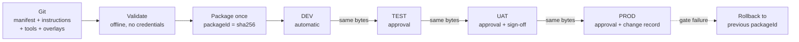

# Foundry Prompt Agent CI/CD Accelerator

Reusable CI/CD patterns, templates, pipelines and automation for **Azure AI Foundry prompt agents**.

Put agent definitions under source control, build an **immutable package once**, and promote that exact
artifact through **DEV -> TEST -> UAT -> PROD** under approval control, with governance gates, automated
testing and one-command rollback.

Built for Microsoft Solution Engineers, Cloud Solution Architects, Customer AI Engineering teams and
enterprise platform teams who need a defensible answer to "what is running in production, who approved it, and
how do we undo it".

> All endpoints, resource names, subscription ids and object ids in this repository are placeholders. Replace
> them for your tenant. See [config/environments/README.md](config/environments/README.md).

---

## What you get

| Capability | Where |
| --- | --- |
| Source-controlled agent definition: manifest, instructions, tools, evaluations | `templates/prompt-agent`, `samples/` |
| Immutable, content-addressed package format | `scripts/New-AgentPackage.ps1`, [docs/package-format.md](docs/package-format.md) |
| Promotion without rebuild, DEV to TEST to UAT to PROD | `scripts/promote-agent.ps1` |
| Rollback to a previously promoted artifact | `scripts/Invoke-Rollback.ps1` |
| GitHub Actions with OIDC and environment approvals | `.github/workflows/` |
| Azure DevOps with workload identity federation and environment checks | `azure-devops/pipelines/` |
| Infrastructure as code, Bicep and Terraform | `infra/bicep/`, `infra/terraform/` |
| Governance gates enforced at deploy time | `config/environments/`, [docs/governance.md](docs/governance.md) |
| Evaluations, regression and smoke tests | `tests/` |
| Offline validation with no Azure credentials | `scripts/Invoke-Validation.ps1` |
| Bring an existing portal-built agent under control | `scripts/export-agent.ps1` |

---

## Quick start

Requires **PowerShell 7.2+** and Git. Azure CLI, Bicep and Terraform are optional for the offline path.

```powershell
git clone https://github.com/OWNER/foundry-prompt-agent-cicd-accelerator.git
cd foundry-prompt-agent-cicd-accelerator

# 1. Validate everything, offline, with no Azure credentials
./scripts/Invoke-Validation.ps1

# 2. Build an immutable package from a sample
./scripts/New-AgentPackage.ps1 -AgentPath ./samples/simple-agent -OutputDirectory ./out

# 3. Verify it
./scripts/Test-AgentPackage.ps1 -PackagePath ./out/simple-support-agent-1.0.0+<sha>.zip

# 4. See exactly what would be sent to production. Still no credentials: -WhatIf returns before any token.
./scripts/import-agent.ps1 -PackagePath ./out/simple-support-agent-1.0.0+<sha>.zip -Environment prod -WhatIf
```

Then deploy for real:

```powershell
az login
$env:AZURE_SUBSCRIPTION_ID = '<your subscription guid>'
./scripts/import-agent.ps1 -PackagePath ./out/simple-support-agent-1.0.0+<sha>.zip -Environment dev
./scripts/promote-agent.ps1 -AgentName simple-support-agent -FromEnvironment dev -ToEnvironment test -ArtifactDirectory ./out
```

Full setup: [docs/deployment-runbook.md](docs/deployment-runbook.md) RB-01.

---

## How it works



Three ideas carry the whole design:

1. **The manifest is environment neutral.** Everything that differs per environment lives in an overlay.
2. **The package is built once and is content addressed.** `packageId` is the SHA-256 of the checksum manifest
   over every packaged file. Promotion moves the identical artifact; it never rebuilds.
3. **Governance is evaluated at the environment boundary.** The same package can be legal in TEST and rejected
   in PROD, and the rejection happens before anything is written.

More: [docs/architecture.md](docs/architecture.md).

---

## Repository layout

```
.github/workflows/      validate, deploy-dev, deploy-test, deploy-prod, rollback + reusable workflows
azure-devops/pipelines/ the same flows as Azure Pipelines, with shared stage and step templates
config/environments/    one file per target: endpoints, release store, governance policy
docs/                   architecture, patterns, branching, environments, governance, runbook, troubleshooting
docs/diagrams/          Mermaid diagrams: GitHub, Azure DevOps, promotion, agent + knowledge + tools
infra/bicep/            Foundry account and project, Key Vault, storage, AI Search, monitoring, RBAC
infra/terraform/        the same, using azurerm plus azapi for the Foundry project
samples/                simple-agent, rag-agent, multi-tool-agent - realistic and fully validated
schemas/                JSON Schema contracts for manifests, overlays, tools, suites, packages, releases
scripts/                export, import, promote, package, verify, rollback, validate + shared module
templates/              starting points for a new agent, its tools and its evaluations
tests/                  evaluations, regression, smoke, and offline unit tests
```

---

## Samples

| Sample | Demonstrates |
| --- | --- |
| [`samples/simple-agent`](samples/simple-agent) | The minimum valid agent. No tools. Prove the pipeline first. |
| [`samples/rag-agent`](samples/rag-agent) | Azure AI Search plus a project vector store, with per-environment index binding and grounding gates. |
| [`samples/multi-tool-agent`](samples/multi-tool-agent) | Five tools, two of them disabled in UAT and PROD by overlay, Key Vault references, an inlined OpenAPI spec, three-layer egress control. Read this one. |

All three resolve and pass governance in all four environments; `Invoke-Validation.ps1` proves it on every
run.

---

## Scripts

| Script | Purpose | Needs Azure |
| --- | --- | --- |
| `Invoke-Validation.ps1` | Full offline validation suite | no |
| `New-AgentPackage.ps1` | Build the immutable package | no |
| `Test-AgentPackage.ps1` | Verify integrity, content address and per-environment resolution | no |
| `import-agent.ps1` | Deploy a package to one environment | yes (`-WhatIf` does not) |
| `promote-agent.ps1` | Promote the identical artifact forward | yes |
| `Invoke-Rollback.ps1` | Redeploy the previously promoted package | yes |
| `export-agent.ps1` | Bring a portal-built agent into source control | yes, read-only |

All are PowerShell 7, strict mode, with `SupportsShouldProcess` on everything that mutates state.
[scripts/README.md](scripts/README.md) has the details.

---

## Security posture

- **No secrets in source.** Ever. Validation runs credential heuristics on every pull request.
- **No long-lived credentials.** GitHub OIDC and Azure DevOps workload identity federation only. There is no
  client secret to store or rotate.
- **Local authentication disabled** on the Foundry account, Azure AI Search and storage, so there is no API
  key or connection string to leak.
- **Secrets are referenced, not embedded.** `@Microsoft.KeyVault(VaultName=...;SecretName=...)` in the
  overlay, resolved at deploy time into a `SecureString` that is never printed, logged or packaged.
- **Least privilege.** The deployment identity holds exactly three data-plane roles.
- **Tamper-evident artifacts.** Integrity and content address are re-verified before every deployment.

Details and reporting process: [SECURITY.md](SECURITY.md).

---

## Requirements

| Component | Version | Needed for |
| --- | --- | --- |
| PowerShell | 7.2+ | everything |
| Git | any recent | source control |
| Azure CLI | 2.60+ | deployment, Bicep, Key Vault, storage |
| Bicep | via `az bicep install` | Bicep path |
| Terraform | 1.9+ | Terraform path |
| Pester | 5.5+ (optional) | unit tests |
| PSScriptAnalyzer | any (optional) | lint |
| `powershell-yaml` or PyYAML | optional | full YAML parse; a structural lint is used otherwise |

Validation never installs tooling. Missing optional tools are reported as **skipped**, never as passed.

### Azure prerequisites (user supplied)

Per environment: an Azure AI Foundry account with project management enabled, a project, at least one model
deployment, a Key Vault, a storage account for release records, and optionally Azure AI Search.
`infra/bicep` and `infra/terraform` create all of it. Foundry project connections are created once per
environment outside IaC, because they carry credentials.

---

## Known limitations

Stated plainly, because a template that hides its edges is worse than one that does not.

1. **The Agent Service data plane api-version must be verified for your tenant.** It is pinned explicitly in
   `config/environments/*.json` and a read-only preflight runs before every write, so a mismatch fails clearly
   instead of half-configuring an agent. It is not auto-detected.
2. **Foundry project connections are not created by the IaC.** They carry credentials that would have to pass
   through template parameters. Create them once per environment, then reference them by name.
3. **Search index schema and content are out of scope.** The agent binds to an index by name; the index
   lifecycle belongs to a knowledge pipeline.
4. **`ai-quality` evaluators are an extension point.** The runner raises an explicit error rather than
   reporting an unmeasured pass. Deterministic evaluators work out of the box.
5. **Canary traffic splitting is an application concern.** The Agent Service has no traffic split; the
   accelerator can deploy two agents but cannot route between them.
6. **Preview capability hosts (bring-your-own storage, search and Cosmos DB) are not templated.** The resource
   shape has changed across API versions; adopt it deliberately.
7. **Pipelines cannot be executed locally.** Everything they call can be, and is, which is why
   `Invoke-Validation.ps1` exists.

---

## Documentation

| Document | Read it when |
| --- | --- |
| [architecture.md](docs/architecture.md) | You want the design and the reasoning |
| [deployment-patterns.md](docs/deployment-patterns.md) | You are deciding how to structure repositories and environments |
| [package-format.md](docs/package-format.md) | You need the artifact specification |
| [branching-strategy.md](docs/branching-strategy.md) | You are setting up branches, tags and protection |
| [environment-management.md](docs/environment-management.md) | You are configuring environments, overlays and secrets |
| [governance.md](docs/governance.md) | You need to evidence control to a security or audit reviewer |
| [deployment-runbook.md](docs/deployment-runbook.md) | You are doing the work: setup, deploy, promote, roll back |
| [troubleshooting.md](docs/troubleshooting.md) | Something failed |

Diagrams: [GitHub to Foundry](docs/diagrams/github-to-foundry.md),
[Azure DevOps to Foundry](docs/diagrams/azure-devops-to-foundry.md),
[multi-environment promotion](docs/diagrams/multi-environment-promotion.md),
[agent, knowledge and tools](docs/diagrams/agent-knowledge-tools.md).

---

## Contributing

See [CONTRIBUTING.md](CONTRIBUTING.md). The short version: no secrets, no invented APIs, fail loudly, keep
offline validation offline, and ASCII only.

## License

[MIT](LICENSE).

This project is a community accelerator. It is not an official Microsoft product and carries no support
commitment. Azure AI Foundry evolves; verify the data plane contract against your tenant before relying on it
in production.
