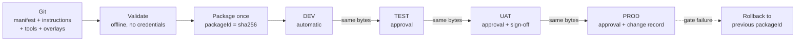

# Foundry Prompt Agent CI/CD Accelerator

Reusable CI/CD patterns, templates, pipelines and automation for **Azure AI Foundry prompt agents**.

Put agent definitions under source control, build an **immutable package once**, and promote that exact
artifact through **DEV -> TEST -> UAT -> PROD** under approval control, with governance gates, automated
testing and one-command rollback.

Built for Microsoft Solution Engineers, Cloud Solution Architects, Customer AI Engineering teams and
enterprise platform teams who need a defensible answer to "what is running in production, who approved it, and
how do we undo it".

> Community accelerator, not production certification: **no authenticated Azure qualification has been
> performed for this repair tranche**. Offline checks do not prove deployment or live inference works in
> your tenant. All endpoints, resource names, subscription ids and object ids are placeholders; replace them
> for your tenant. See [config/environments/README.md](config/environments/README.md).

---

## What you get

| Capability | Where |
| --- | --- |
| Source-controlled agent definition: manifest, instructions, tools, evaluations | `templates/prompt-agent`, `samples/` |
| Immutable, content-addressed package format | `scripts/New-AgentPackage.ps1`, [docs/package-format.md](docs/package-format.md) |
| Promotion without rebuild, DEV to TEST to UAT to PROD | `scripts/promote-agent.ps1` |
| Rollback to a previously promoted artifact | `scripts/Invoke-Rollback.ps1` |
| GitHub Actions with OIDC and environment approvals | `.github/workflows/` |
| Azure DevOps with workload identity federation and environment checks | `azure-devops/pipelines/` |
| Infrastructure as code, Bicep and Terraform | `infra/bicep/`, `infra/terraform/` |
| Governance gates enforced at deploy time | `config/environments/`, [docs/governance.md](docs/governance.md) |
| Evaluations, regression and smoke tests | `tests/` |
| Offline validation with no Azure credentials | `scripts/Invoke-Validation.ps1` |
| Bring an existing portal-built agent under control | `scripts/export-agent.ps1` |

---

## Quick start

Requires **PowerShell 7.2+** and Git. Azure CLI, Bicep and Terraform are optional for the offline path.

```powershell
git clone https://github.com/rob-mckenna/foundry-prompt-agent-cicd-accelerator.git
Set-Location foundry-prompt-agent-cicd-accelerator
$ErrorActionPreference = 'Stop'

# 1. Build once; capture the actual archive path returned by the builder.
$package = .\scripts\New-AgentPackage.ps1 -AgentPath .\samples\simple-agent -OutputDirectory .\out\quickstart

# 2. Verify integrity, content identity and DEV policy without production change/sign-off references.
.\scripts\Test-AgentPackage.ps1 -PackagePath $package.PackagePath -Environment dev

# 3. Review the DEV structural summary. No Azure credentials or Python required.
$env:AZURE_SUBSCRIPTION_ID = '00000000-0000-0000-0000-000000000000'
$env:AZURE_TENANT_ID = '11111111-1111-1111-1111-111111111111'
.\scripts\import-agent.ps1 -PackagePath $package.PackagePath -Environment dev -WhatIf
```

Plain `-WhatIf` returns before authentication or SDK calls. It does not validate the live service, external
dependencies or approvals. Do not add `-ValidateSecretReferences` to an offline rehearsal: it reads Key Vault.
The verifier defaults to all packaged environments; the explicit DEV selection avoids PROD change-record
requirements. The GUIDs above are dummy identifiers for offline resolution only; replace both before a real
operation. For broader offline repository checks, run `.\scripts\Invoke-Validation.ps1 -SkipInfrastructure`.

For real deployment **and live smoke/evaluation/regression**, promotion, rollback and export-by-name
operations, install the pinned Python SDK bridge. Python 3.10+ is required; a virtual environment is recommended.

```powershell
python -m pip install -r .\scripts\python\requirements.txt
```

After configuring a non-production Azure project, dependencies and identity, deploy and attest DEV:

```powershell
az login
$env:AZURE_SUBSCRIPTION_ID = '<your subscription guid>'
$env:AZURE_TENANT_ID = '<your tenant guid>'
$deploy = .\scripts\import-agent.ps1 -PackagePath $package.PackagePath -Environment dev
.\tests\smoke\Invoke-SmokeTest.ps1 -Environment dev -AgentName simple-support-agent -ExpectedVersion 1.0.0 `
  -ReleaseRecordPath $deploy.ReleaseRecord -ResultPath .\out\quickstart\smoke-dev.json
.\scripts\Complete-Release.ps1 -ReleaseRecordPath $deploy.ReleaseRecord -PackagePath $package.PackagePath `
  -SmokeResultPath .\out\quickstart\smoke-dev.json
```

Import activates a service version but returns `pending-verification`; it is **not** a successful release.
Only `Complete-Release.ps1` can attest passing, release-bound live evidence and mark it `succeeded` before
promotion. `-ExpectedVersion 1.0.0` is manifest semver, not the opaque SDK `agent.serviceVersion` recorded
by deployment. Each target promotion needs its own live gates and attestation.

Full deploy/promote sequence: [scripts/README.md](scripts/README.md). Tenant setup and qualification:
[docs/deployment-runbook.md](docs/deployment-runbook.md) RB-01.

---

## How it works



Three ideas carry the whole design:

1. **The manifest is environment neutral.** Everything that differs per environment lives in an overlay.
2. **The package is built once and is content addressed.** `foundry-agent-package/2` binds canonical stable
   descriptor fields and source-file checksums. Informational build time/run/ref/builder fields are excluded
   from the content ID but still checksummed. Equal IDs do not guarantee byte-identical ZIPs; publishing
   different archive bytes at an existing ID is a conflict. Promotion retains the original archive unchanged.
   Strict descriptor-bound `/1` verification remains supported; malformed legacy packages are not repaired.
3. **Governance is evaluated at the environment boundary.** The same package can be legal in TEST and rejected
   in PROD before runtime mutation. Overlays can change model/tool bindings, so identical package bytes do not
   mean identical effective environments. Neither packaging nor rollback freezes models, knowledge or tools.

More: [docs/architecture.md](docs/architecture.md).

---

## Repository layout

```
.github/workflows/      validate, deploy-dev, deploy-test, deploy-prod, rollback + reusable workflows
azure-devops/pipelines/ the same flows as Azure Pipelines, with shared stage and step templates
config/environments/    one file per target: endpoints, release store, governance policy
docs/                   architecture, patterns, branching, environments, governance, runbook, troubleshooting
docs/diagrams/          Mermaid diagrams: GitHub, Azure DevOps, promotion, agent + knowledge + tools
infra/bicep/            Foundry account and project, Key Vault, storage, AI Search, monitoring, RBAC
infra/terraform/        the same, using azurerm plus azapi for the Foundry project
samples/                simple-agent, rag-agent, multi-tool-agent - illustrative configurations, not Azure-qualified
schemas/                JSON Schema contracts for manifests, overlays, tools, suites, packages, releases
scripts/                export, import, promote, package, verify, rollback, validate + shared module
templates/              starting points for a new agent, its tools and its evaluations
tests/                  evaluations, regression, smoke, and offline unit tests
```

---

## Samples

| Sample | Demonstrates |
| --- | --- |
| [`samples/simple-agent`](samples/simple-agent) | The minimum valid agent. No tools. Prove the pipeline first. |
| [`samples/rag-agent`](samples/rag-agent) | Azure AI Search plus a project vector store, with per-environment index binding and grounding gates. |
| [`samples/multi-tool-agent`](samples/multi-tool-agent) | Five tools, two disabled in UAT and PROD by overlay, Key Vault references, an inlined OpenAPI spec and layered tool policy. |

Offline resolution checks configuration shape, not working tools or answer quality. PROD policy also needs
real change/sign-off references at deployment. Model deployment names are examples: qualify model availability,
version, retirement dates and behaviour in your region before use. See [samples/README.md](samples/README.md).

---

## Scripts

| Script | Purpose | Needs Azure |
| --- | --- | --- |
| `Invoke-Validation.ps1` | Full offline validation suite | no |
| `New-AgentPackage.ps1` | Build the immutable package | no |
| `Test-AgentPackage.ps1` | Verify integrity, content address and per-environment resolution | no |
| `import-agent.ps1` | Deploy a package to one environment | yes (`-WhatIf` does not) |
| `promote-agent.ps1` | Promote the identical artifact forward | yes |
| `Invoke-Rollback.ps1` | Redeploy the previously promoted package | yes |
| `Complete-Release.ps1` | Attest release-bound live gate evidence | yes |
| `export-agent.ps1` | Bring a portal-built agent into source control | yes, read-only |

All are PowerShell 7, strict mode, with `SupportsShouldProcess` on everything that mutates state.
[scripts/README.md](scripts/README.md) has the details.

---

## Security posture

- **Keep secrets out of source.** Validation runs credential heuristics; that is not proof that no secret exists.
- **Federated CI identity.** The supplied workflows use GitHub OIDC and Azure DevOps workload identity
  federation rather than stored client secrets; configure the trust and permissions externally.
- **No separate Python secret.** The SDK bridge uses `DefaultAzureCredential`, which reuses the Azure CLI,
  OIDC or workload identity context already established for the rest of the pipeline.
- **Local authentication disabled** on the Foundry account, Azure AI Search and storage in the supplied IaC.
  Qualify downstream connections and dependencies separately.
- **Secrets are referenced, not embedded.** `@Microsoft.KeyVault(VaultName=...;SecretName=...)` in the
  overlay can be read into a `SecureString` by `-ValidateSecretReferences` and is never printed, logged or
  packaged. The current SDK bridge does not inject that value; use Foundry project connections for runtime
  credentials.
- **Scoped role assignments.** The IaC assigns deployment roles; tool/runtime dependencies may need additional,
  separately reviewed permissions.
- **Tamper-evident artifacts.** Integrity and content address are re-verified before every deployment.
- **External approval setup.** Configure GitHub Environment rules or Azure DevOps checks before deployment.
  GitHub required reviewers are **one-of**, not unanimous approval by every listed team. Use separate enforced
  gates when your process requires multiple independent approvals; repository YAML alone does not create them.

Details and reporting process: [SECURITY.md](SECURITY.md).

---

## Requirements

| Component | Version | Needed for |
| --- | --- | --- |
| PowerShell | 7.2+ | everything |
| Git | any recent | source control |
| Python | 3.10+ | deployment, live tests, promotion, rollback, export by name |
| Azure CLI | 2.60+ | deployment, Bicep, Key Vault, storage |
| Bicep | via `az bicep install` | Bicep path |
| Terraform | 1.9+ | Terraform path |
| Pester | 5.5+ (optional) | unit tests |
| PSScriptAnalyzer | any (optional) | lint |
| `powershell-yaml` or PyYAML | optional | full YAML parse; a structural lint is used otherwise |

Validation never installs tooling. Missing optional tools are reported as **skipped**, never as passed.
Deployment and live runtime use pinned Python dependencies from
[`scripts/python/requirements.txt`](scripts/python/requirements.txt): `azure-ai-projects==2.7.0`,
`azure-identity==1.26.0`, `azure-core==1.41.0`, `openai==3.17.0`.
Runtime explicitly opts into preview with `AIProjectClient(..., allow_preview=True)` and uses the
agent-bound OpenAI Conversations/Responses client. Treat that path as preview-dependent, not a GA guarantee.
Deployment and runtime both use the SDK bridge; classic REST is retained only for legacy export-by-ID.

### Azure prerequisites (user supplied)

Per environment: an Azure AI Foundry account with project management enabled, a project, at least one model
deployment, a Key Vault, a storage account for release records, and optionally Azure AI Search.
The supplied IaC provisions the base account/project, vault, storage, Search service and monitoring; it does
not provision every dependency. Supply and qualify model deployments, project connections, indexes/content,
vector stores and any Function/API/Bing dependencies required by your sample. Connections can use Entra
authentication and can be created through IaC, but these templates do not create them.

---

## Known limitations

Stated plainly, because a template that hides its edges is worse than one that does not.

1. **The retained REST api-version must be verified for legacy export-by-ID.** It is pinned explicitly in
   `config/environments/*.json`. SDK deployment and live runtime do not consume or validate it; changing it
   does not qualify the SDK's own service contract.
2. **The Python `azure-ai-projects` SDK is a moving dependency.** Keep it pinned, test upgrades before
   adopting them, and expect the SDK object model to change across releases even when the REST `apiVersion`
   does not.
3. **Foundry project connections are not created by this IaC.** Configure them per environment, using Entra
   authentication where supported, then reference them by name.
4. **Search index schema and content are out of scope.** The agent binds to an index by name; the index
   lifecycle belongs to a knowledge pipeline.
5. **`ai-quality` evaluators are an extension point.** The runner raises an explicit error rather than
   reporting an unmeasured pass. Deterministic evaluators work out of the box.
6. **Canary traffic splitting is not implemented.** The bridge promotes one version to 100% traffic. Deploy
   two logical agents and route between them in the calling application if you need a canary.
7. **Capability hosts and Standard Setup are not templated.** The Azure Functions queue tool needs Standard
   Setup plus deployed Function code, dependencies, queues and permissions; creating queues alone is not enough.
8. **Offline checks are not pipeline execution.** `Invoke-Validation.ps1` exercises local checks, not hosted
   approval rules, workload federation or Azure deployment.
9. **No authenticated Azure qualification was performed.** Mock tests and real-SDK offline request capture
   are not service evidence. Qualify endpoint routing, identity, create-version, promotion, live runtime and
   recovery in a non-production project first. This repository does not certify production readiness.
10. **Version description and custom metadata use the version operation, not `PromptAgentDefinition`.** The
    bridge passes them as the pinned SDK's supported `create_version(..., description=..., metadata=...)`
    arguments. Code-interpreter file ids still have no mapped SDK equivalent and are omitted with a warning.
11. **Portal export is a qualification step, not a lossless round trip.** Export-by-name reads the active
    version through the SDK, not simply latest; `-RemoteAgentId` retains the legacy REST get-by-ID fallback.
    Both produce `export-notes.md`, placeholders and only one overlay. Review tool mappings and author the remaining
    governance data and overlays, merge the result through a reviewed pull request, and verify an attested
    pipeline-created version before deleting or disabling the portal-authored version.
12. **Release records remain strictly schema-validated.** The schema covers constrained gate attestation,
    evidence and staged rollback fields; unknown fields and incomplete retained-artifact state are rejected.
13. **Rollback needs a retained known-good package and attested release JSON.** The exact failed/current
    release context selects recovery, which creates a new service version and runs the target package's live
    gates before reporting success. First deployment without a prior artifact needs manual recovery. Rollback
    does not revoke or delete older versions, revert external data, or guarantee a frozen model response.

---

## Documentation

| Document | Read it when |
| --- | --- |
| [architecture.md](docs/architecture.md) | You want the design and the reasoning |
| [deployment-patterns.md](docs/deployment-patterns.md) | You are deciding how to structure repositories and environments |
| [package-format.md](docs/package-format.md) | You need the artifact specification |
| [branching-strategy.md](docs/branching-strategy.md) | You are setting up branches, tags and protection |
| [environment-management.md](docs/environment-management.md) | You are configuring environments, overlays and secrets |
| [governance.md](docs/governance.md) | You need to evidence control to a security or audit reviewer |
| [deployment-runbook.md](docs/deployment-runbook.md) | You are doing the work: setup, deploy, promote, roll back |
| [troubleshooting.md](docs/troubleshooting.md) | Something failed |

Diagrams: [GitHub to Foundry](docs/diagrams/github-to-foundry.md),
[Azure DevOps to Foundry](docs/diagrams/azure-devops-to-foundry.md),
[multi-environment promotion](docs/diagrams/multi-environment-promotion.md),
[agent, knowledge and tools](docs/diagrams/agent-knowledge-tools.md).

---

## Contributing

See [CONTRIBUTING.md](CONTRIBUTING.md). The short version: no secrets, no invented APIs, fail loudly, keep
offline validation offline, and ASCII only.

## License

[MIT](LICENSE).

This project is a community accelerator. It is not an official Microsoft product and carries no support
commitment. Azure AI Foundry evolves; verify the data plane contract against your tenant before relying on it
in production.
