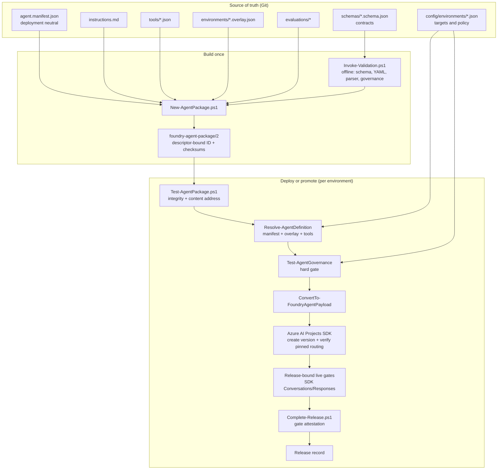
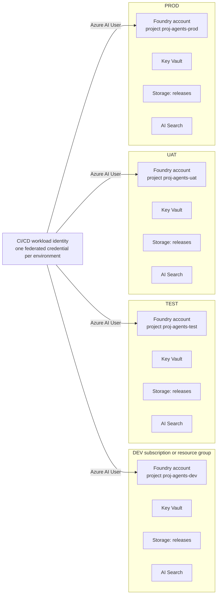
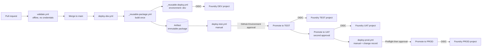
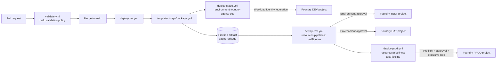
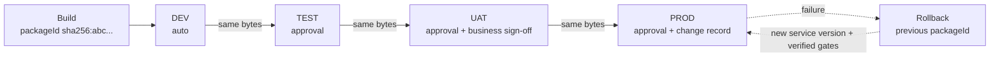
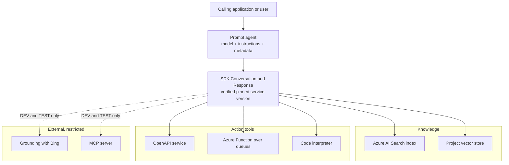

# Architecture

## Problem

An Azure AI Foundry prompt agent is configuration: a model deployment, an instruction text, a set of tools and
a set of connections. That configuration is easy to change in the portal and hard to govern. Without a
pipeline you get agents whose behaviour nobody can reconstruct, changes nobody reviewed, and no way to answer
"what exactly is running in production and who approved it".

This accelerator treats the agent definition as source, builds it into an immutable artifact once, and
promotes that same artifact through DEV, TEST, UAT and PROD under approval control.
This is a community reference implementation, not a Microsoft-supported product or an Azure-qualified
deployment. Offline source/SDK evidence is distinct from a successful authenticated service rehearsal.

## Core design decisions

| Decision | Rationale |
| --- | --- |
| Manifest is deployment neutral | One definition, four environments. Environment differences live only in overlays. |
| Build once, promote the same archive | Packaged source is unchanged; target overlays, model deployments, tools, connections, knowledge and secrets can yield different behaviour. Each environment needs its own live gates. |
| Descriptor-bound package identity | `/2` hashes the format, canonical stable descriptor projection and content checksum manifest. It reproduces identity, not necessarily ZIP bytes; strict `/1` verification remains. |
| Overlays ship inside the package | Promotion needs no repository access and no rebuild. The TEST overlay is already in the artifact built for DEV. |
| Release records live outside the package | Writing a deployment record into the package would change its hash and break immutability. |
| Governance evaluated at deploy time | The same package can be legal in TEST and illegal in PROD. The gate belongs at the environment boundary. |
| Approvals live in the platform | GitHub Environments and Azure DevOps Environments are auditable and cannot be weakened by a pull request to this repository. |
| Management and live tests use the Projects SDK | Version creation and verified fixed routing share the bridge with agent-bound OpenAI Conversations/Responses. REST remains only for legacy export-by-id. |
| Rollback is a verified redeploy of a prior package | Known-good package plus attested release JSON, deployed as a new service version and re-tested; not a frozen external/runtime snapshot. |
| Tool mapping is centralised and strict | `ConvertTo-FoundryAgentPayload` raises an error on an unknown tool type, so a mistyped tool cannot silently vanish from a deployment. |

## Component model



## Deployment topology

One Foundry account and project per environment, in its own resource group, with its own Key Vault, release
store and optional Azure AI Search service. Separation is by subscription or resource group, not by project
inside a shared account, so that blast radius and RBAC follow the environment boundary.



## GitHub to Foundry

Full diagram and narrative: [diagrams/github-to-foundry.md](diagrams/github-to-foundry.md).



## Azure DevOps to Foundry

Full diagram and narrative: [diagrams/azure-devops-to-foundry.md](diagrams/azure-devops-to-foundry.md).



## Multi-environment promotion

Full diagram and narrative: [diagrams/multi-environment-promotion.md](diagrams/multi-environment-promotion.md).



## Agent, knowledge and tools

Full diagram and narrative: [diagrams/agent-knowledge-tools.md](diagrams/agent-knowledge-tools.md).



## Identity and trust

```mermaid
sequenceDiagram
    participant WF as GitHub Actions job
    participant EID as Microsoft Entra ID
    participant KV as Key Vault
    participant AS as Agent Service
    participant ST as Release store

    WF->>EID: OIDC token for repo:owner/repo:environment:prod
    EID-->>WF: Access token (Azure AI User)
    Note over WF,EID: No client secret exists anywhere
    WF->>KV: Read secret referenced by the overlay
    KV-->>WF: SecureString, never logged
    WF->>AS: SDK deployments.list() preflight
    AS-->>WF: reachable endpoint confirms auth and endpoint
    WF->>AS: Read supported pinned active route
    WF->>ST: Stage prior package + attested release; publish candidate
    WF->>ST: Persist prepared record and mutation started
    WF->>AS: SDK create_version + update_details
    AS-->>WF: logical id + service version; read back routing
    WF->>ST: Persist verified activation completion
    WF->>AS: Shared SDK Conversations/Responses runtime
    AS-->>WF: Release-bound live gate evidence
    WF->>ST: Complete-Release attests succeeded or failed
```

The preflight matters: it proves that the project endpoint, Azure identity and Python SDK bridge are usable
before any version is created. It is not proof of runtime tool behaviour or post-deployment success.
It does not prove the configured REST `apiVersion`: the SDK selects its own service version.
`foundry.apiVersion` remains relevant to legacy `GET /assistants/{id}` export only.

In GitHub Actions, `_reusable-deploy.yml` satisfies the runtime prerequisite by installing Python 3.11 and
`scripts/python/requirements.txt` before the deploy or promote step. Local operators need the same
prerequisite for any non-`-WhatIf` deploy, promote or export-by-name operation.

## Data plane contract

`config/environments/<env>.json` pins the contract explicitly:

```json
"foundry": {
  "projectEndpoint": "https://<account>.services.ai.azure.com/api/projects/<project>",
  "apiVersion": "v1",
  "tokenScope": "https://ai.azure.com/.default"
}
```

Operations used by the accelerator:

| Operation | Surface |
| --- | --- |
| Preflight and logical-name discovery | Azure AI Projects SDK (`deployments.list()`, `agents.get(...)`) |
| Create a new immutable agent version | Azure AI Projects SDK (`agents.create_version(...)`) |
| Promote the active version | Azure AI Projects SDK (`agents.update_details(...)`) |
| Read one agent by opaque id for manual export | `GET {endpoint}/assistants/{id}` |
| Bind live calls to the logical agent endpoint | `get_openai_client(agent_name=...)`, with explicit `allow_preview=True` on the Projects client |
| Start a test conversation | OpenAI SDK `conversations.create()` |
| Invoke and read a reply | `responses.create(conversation=..., input=...)`; `responses.retrieve(...)` while nonterminal |
| Clean up a test conversation | `conversations.delete(...)` in `finally` |

Direct REST is not a deployment write or live-test path; only opaque-id legacy export retains it.
Smoke, evaluation and regression all call the shared
`Invoke-FoundryAgentRun -EnvironmentConfig -LogicalName -AgentVersion <service version> -Prompt -TimeoutSeconds`
helper. Prompt/settings enter the Python bridge through stdin. There is no classic thread/run fallback.

The [Projects client reference](https://learn.microsoft.com/en-us/python/api/azure-ai-projects/azure.ai.projects.aiprojectclient?view=azure-python)
documents preview opt-in for agent-bound `get_openai_client`. The bridge explicitly sets `allow_preview=True`;
the installed 2.7.0 implementation does not enforce the docstring's claimed missing-flag exception.
Treat this preview surface as an adoption risk, not a GA or production-support guarantee.

Repository validation has not performed authenticated Azure deployment, inference or rollback.
Mock tests and offline SDK construction/request capture with `azure-ai-projects==2.7.0` and `openai==3.17.0`
can establish serialization/interface compatibility, not service acceptance, authorization, tool execution
or operational recovery. Qualify those paths in a non-production project before adoption.

### Serving identity and evidence

Manifest `agent.version` (and smoke `-ExpectedVersion`) is semver. A release separately records opaque
`agent.serviceVersion` and `agent.serviceVersionId`; `remoteAgentId` is the logical resource id.
Discovery distinguishes `latestVersion` from `activeVersion` and reads the active version's definition.
`latest.json` is only the latest audit attempt.

Managed live operation requires an enabled Responses endpoint with exactly one explicit concrete
`FixedRatioVersionSelectionRule` at 100%. Latest/dynamic, split, disabled, missing or unknown routing
fails closed before mutation; pin a known version deliberately rather than guessing from latest.
Activation is complete only after selector readback agrees with the candidate. The agent-bound client
has no invented service-version parameter: live calls verify the selector before and after invocation.
Only completed Responses with usable text and no unresolved client tool/approval requirement can pass;
failures, incomplete output and timeouts cannot become fabricated success.

Deploy, test and rollback must be serialized for the same agent/environment. GitHub shares one concurrency
identity; Azure DevOps uses the same Environment with sequential lock behaviour and requires an externally
configured exclusive-lock check. Out-of-band routing changes are unsupported. Before/after checks detect
observed drift, not every transient edit or a service-signed proof of uninterrupted routing.

New `1.1.0` releases persist mutation-started evidence **before** `create_version`, retain ambiguous create
outcomes as potentially mutated, and persist completion only after verified routing. They reconcile the
serving version to an attested prior release and stage its package and JSON before changing anything.
First creation can become reachable before explicit selection and gates; this is not zero-exposure or
transactional deployment. Without a prior known-good artifact, failed first deployment needs manual recovery.

Attestable gates receive the exact `-ReleaseRecordPath`, bind package/release/project/manifest/service identity
and timestamps after activation, and retain result-byte hashes and completed Response IDs. Required smoke
needs a live canary; fixtures, skipped canaries, baseline updates and unbound legacy results cannot authorize
promotion. Rollback uses that same gate/attestation path and reports recovery only after success, while the
original deployment remains failed. See [package-format.md](package-format.md) for the evidence contract.

## What this accelerator does not own

| Concern | Owner | Why |
| --- | --- | --- |
| Search index schema and content | knowledge pipeline | Data has a different change cadence from the agent |
| Foundry project connections | platform team, once per environment | These templates do not provision connections; Entra-authenticated connections can be IaC-managed, while credential-based connections need secure secret handling |
| Model capacity and quota | platform team | Subscription level concern |
| Client applications calling the agent | application teams | The agent is a dependency, not the product |
| Network isolation and private DNS | landing zone | Organisation-wide standard |
| Python runtime and pinned SDK installation | runner image or operator workstation | Real deploy, promote and export-by-name operations require Python 3.10+ plus `scripts/python/requirements.txt`; the shipped GitHub and Azure DevOps deployment flows provision Python 3.11 and install the pins |

### Current SDK mapping boundary

The bridge maps model, instructions, sampling values, response format and supported tools into
`PromptAgentDefinition`. Description and custom metadata are version properties, so the bridge passes them
separately to `agents.create_version`; this preserves `logical_name`, `agent_version`, `environment`, and
governance traceability for smoke and discovery. Code-interpreter file ids have no mapped SDK equivalent and
are still omitted with a warning.

## Related documents

- [deployment-patterns.md](deployment-patterns.md) - how a package becomes a deployed agent
- [package-format.md](package-format.md) - the immutable package specification
- [branching-strategy.md](branching-strategy.md) - branches, tags and protection
- [environment-management.md](environment-management.md) - environments, overlays and configuration
- [governance.md](governance.md) - policy, approvals and audit
- [deployment-runbook.md](deployment-runbook.md) - step-by-step operational procedures
- [troubleshooting.md](troubleshooting.md) - failure modes and fixes
