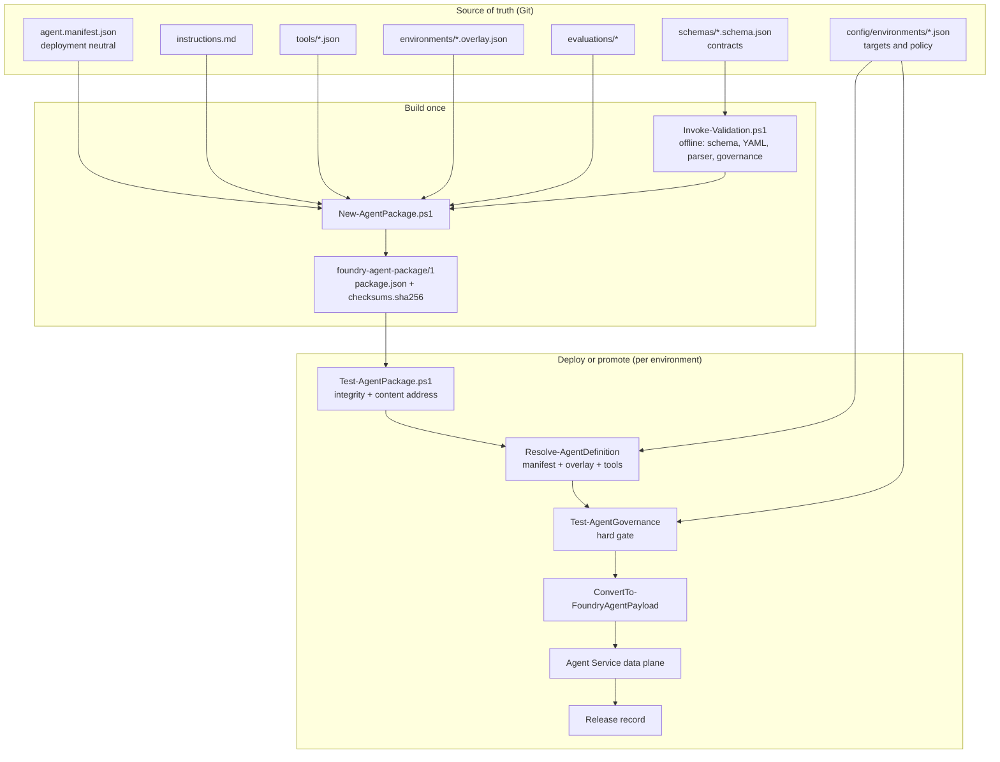
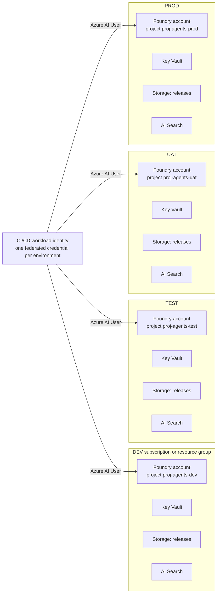
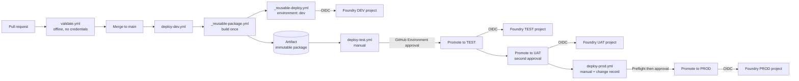
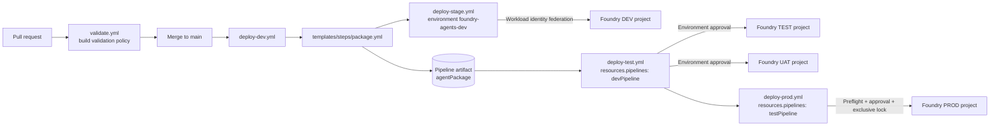
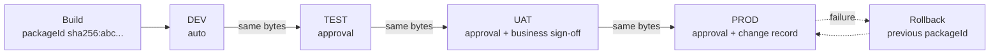
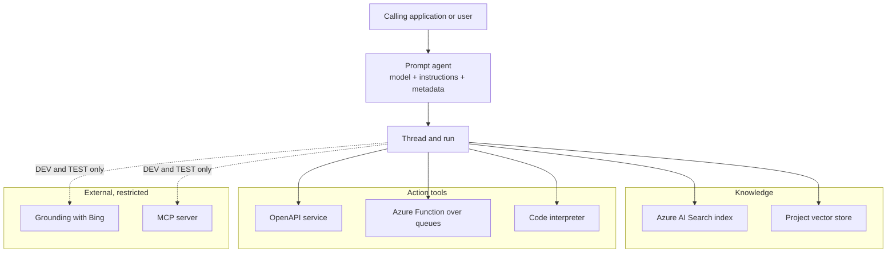
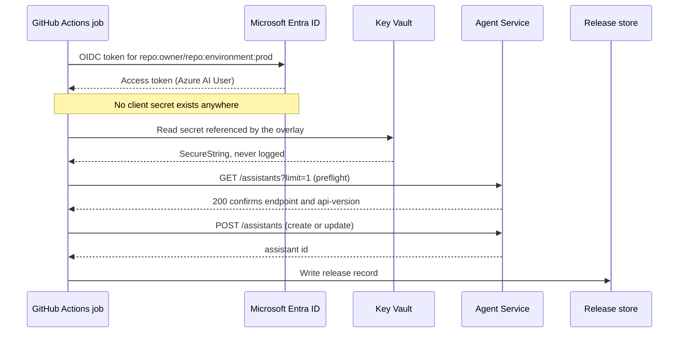

# Architecture

## Problem

An Azure AI Foundry prompt agent is configuration: a model deployment, an instruction text, a set of tools and
a set of connections. That configuration is easy to change in the portal and hard to govern. Without a
pipeline you get agents whose behaviour nobody can reconstruct, changes nobody reviewed, and no way to answer
"what exactly is running in production and who approved it".

This accelerator treats the agent definition as source, builds it into an immutable artifact once, and
promotes that same artifact through DEV, TEST, UAT and PROD under approval control.

## Core design decisions

| Decision | Rationale |
| --- | --- |
| Manifest is deployment neutral | One definition, four environments. Environment differences live only in overlays. |
| Build once, promote the same bytes | Production runs exactly what UAT verified. A rebuild would reintroduce risk at the last gate. |
| Content-addressed package | `packageId` is the SHA-256 of the checksum manifest, so the artifact is self-verifying and tamper evident. |
| Overlays ship inside the package | Promotion needs no repository access and no rebuild. The TEST overlay is already in the artifact built for DEV. |
| Release records live outside the package | Writing a deployment record into the package would change its hash and break immutability. |
| Governance evaluated at deploy time | The same package can be legal in TEST and illegal in PROD. The gate belongs at the environment boundary. |
| Approvals live in the platform | GitHub Environments and Azure DevOps Environments are auditable and cannot be weakened by a pull request to this repository. |
| Rollback is a redeploy of a prior package | Known-good bytes, not a rebuild of older source. |
| Tool mapping is centralised and strict | `ConvertTo-FoundryAgentPayload` raises an error on an unknown tool type, so a mistyped tool cannot silently vanish from a deployment. |

## Component model



## Deployment topology

One Foundry account and project per environment, in its own resource group, with its own Key Vault, release
store and optional Azure AI Search service. Separation is by subscription or resource group, not by project
inside a shared account, so that blast radius and RBAC follow the environment boundary.



## GitHub to Foundry

Full diagram and narrative: [diagrams/github-to-foundry.md](diagrams/github-to-foundry.md).



## Azure DevOps to Foundry

Full diagram and narrative: [diagrams/azure-devops-to-foundry.md](diagrams/azure-devops-to-foundry.md).



## Multi-environment promotion

Full diagram and narrative: [diagrams/multi-environment-promotion.md](diagrams/multi-environment-promotion.md).



## Agent, knowledge and tools

Full diagram and narrative: [diagrams/agent-knowledge-tools.md](diagrams/agent-knowledge-tools.md).



## Identity and trust



The preflight matters: the Agent Service api-version and response shape have changed across releases. A
read-only probe converts a version mismatch into a clear failure before any write, rather than a
half-configured agent.

## Data plane contract

`config/environments/<env>.json` pins the contract explicitly:

```json
"foundry": {
  "projectEndpoint": "https://<account>.services.ai.azure.com/api/projects/<project>",
  "apiVersion": "v1",
  "tokenScope": "https://ai.azure.com/.default"
}
```

Operations used by the accelerator, all through `Invoke-FoundryApi`:

| Operation | Method and path |
| --- | --- |
| Preflight and discovery | `GET {endpoint}/assistants?limit=...` |
| Read one agent | `GET {endpoint}/assistants/{id}` |
| Create | `POST {endpoint}/assistants` |
| Update | `POST {endpoint}/assistants/{id}` |
| Start a test conversation | `POST {endpoint}/threads/runs` |
| Poll a run | `GET {endpoint}/threads/{thread}/runs/{run}` |
| Read the reply | `GET {endpoint}/threads/{thread}/messages` |
| Clean up a test thread | `DELETE {endpoint}/threads/{thread}` |

Verify `apiVersion` against your project before the first deployment. If your organisation standardises on a
different interface, replace the body of `Invoke-FoundryApi` and `ConvertTo-FoundryAgentPayload`: every other
part of the accelerator depends on those two functions and nothing else.

## What this accelerator does not own

| Concern | Owner | Why |
| --- | --- | --- |
| Search index schema and content | knowledge pipeline | Data has a different change cadence from the agent |
| Foundry project connections | platform team, once per environment | They carry credentials that must not appear in template parameters |
| Model capacity and quota | platform team | Subscription level concern |
| Client applications calling the agent | application teams | The agent is a dependency, not the product |
| Network isolation and private DNS | landing zone | Organisation-wide standard |

## Related documents

- [deployment-patterns.md](deployment-patterns.md) - how a package becomes a deployed agent
- [package-format.md](package-format.md) - the immutable package specification
- [branching-strategy.md](branching-strategy.md) - branches, tags and protection
- [environment-management.md](environment-management.md) - environments, overlays and configuration
- [governance.md](governance.md) - policy, approvals and audit
- [deployment-runbook.md](deployment-runbook.md) - step-by-step operational procedures
- [troubleshooting.md](troubleshooting.md) - failure modes and fixes
