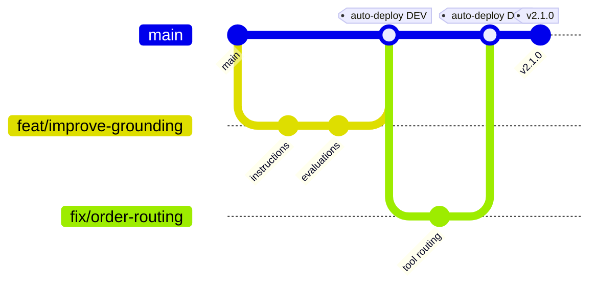
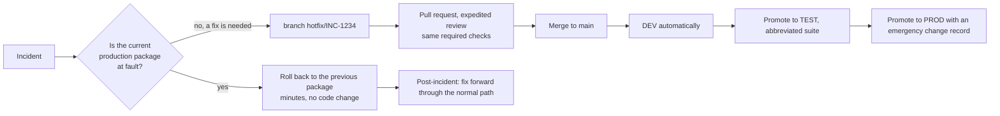

# Branching strategy

## Model

Trunk-based development with short-lived branches, protected `main`, and release tags for production
traceability. Agent definitions are small, review-heavy artifacts; long-lived release branches add merge cost
without adding safety, because the artifact rather than the branch is what gets promoted.



## Branches

| Branch | Lifetime | Protection | Deploys to |
| --- | --- | --- | --- |
| `main` | permanent | protected; pull request, review, required checks, no force push | DEV automatically |
| `feat/<short-description>` | hours to days | none | nothing |
| `fix/<short-description>` | hours | none | nothing |
| `hotfix/<incident-id>` | hours | none; merged through the same review | nothing directly; promoted manually |
| `docs/<topic>` | hours | none | nothing |

No `develop` branch. No `release/*` branches. The promotable artifact is the package, identified by its
content address, not a branch.

## The artifact, not the branch, is what is promoted

This is the point that most often gets missed:

- A merge to `main` builds one package and deploys it to DEV.
- TEST, UAT and PROD deploy **that artifact**, referenced by build run id, not by re-reading `main`.
- `main` may have moved on. That does not affect a promotion in flight, because promotion never reads agent
  source.

So `main` does not need to be frozen during a release, and a release branch would give you nothing that the
retained artifact does not already give you.

## Tags

| Tag | Meaning | Created by |
| --- | --- | --- |
| `v<major>.<minor>.<patch>` | An agent version that reached production | A maintainer, after the production deployment succeeds |
| `pkg/<agent>/<version>` | Optional, when several agents share a repository | A maintainer |

Tag after a successful production deployment, not before. A tag asserts "this version is in production", which
is a fact you only have afterwards. Put the release id and package id in the tag annotation:

```powershell
git tag -a v2.1.0 -m "operations-copilot 2.1.0
packageId: sha256:832e1b6b034a6efe6371228a0c865d07203e950523f4fc63e96ba29723171286
releaseId: operations-copilot-prod-20260915T214459Z-832e1b6b034a
change:    CHG-0043912"
git push origin v2.1.0
```

## Versioning

`agent.manifest.json` carries a semantic version. It is not the repository version; it is the agent's.

| Change | Bump | Examples |
| --- | --- | --- |
| Major | `2.0.0` | The agent's contract changes: a different output format, a removed capability, a new required input from the caller |
| Minor | `2.1.0` | New tool, materially different instructions, new knowledge source |
| Patch | `2.1.1` | Wording clarification, an evaluation case, a typo, a threshold adjustment |

Rules:

1. Bump the version in the same pull request as the change. Validation cannot detect a forgotten bump, but
   review should.
2. Never reuse a version with different content. The package file name includes the version, and two
   different packages with the same name make an audit trail ambiguous.
3. Overlay-only changes still need a bump: they change what is deployed.

## Branch protection

Configure a ruleset on `main`:

| Setting | Value | Why |
| --- | --- | --- |
| Require a pull request | on, 1 approval minimum, 2 for production-affecting paths | No unreviewed change reaches DEV |
| Dismiss stale approvals | on | An approval must apply to the code that merges |
| Require review from Code Owners | on | `.github/CODEOWNERS` routes schema, pipeline and governance changes to the right reviewers |
| Require status checks | `validate` | Offline validation must pass |
| Require branches to be up to date | on | Prevents a semantic conflict between two agents merging at once |
| Require conversation resolution | on | Review comments are not lost |
| Block force pushes | on | History is evidence |
| Restrict deletions | on | - |
| Require signed commits | recommended | Provenance |
| Require linear history | recommended | Bisecting a behaviour regression is much easier |

In Azure DevOps the equivalents are branch policies: minimum reviewers, build validation against
`validate.yml`, required reviewers by path, comment resolution, and merge type restricted to squash.

## Environment deployment policies

Branch protection alone does not stop a deployment. Pair it with environment policies:

| Environment | GitHub | Azure DevOps |
| --- | --- | --- |
| DEV | no protection; branch policy `main` | Environment with no checks |
| TEST | required reviewers; deployment branch policy `main` | Environment approval |
| UAT | required reviewers including the business owner | Environment approval plus business hours |
| PROD | required reviewers, wait timer, branch and tag policy for `main` and `v*.*.*` | Environment approval, business hours, exclusive lock, branch control on `refs/heads/main` |

## Pull request expectations

Every pull request that changes an agent should answer:

1. What behaviour changes, in one sentence.
2. Which environments are affected.
3. Which evaluation or regression cases cover the change. A behaviour change with no test change is a warning
   sign.
4. Whether the version bump matches the size of the change.
5. Whether governance-relevant fields changed: `classification`, tool types, `temperature`.

`.github/pull_request_template.md` contains this as a checklist.

## Hotfix flow

A production incident does not get a different, weaker path. It gets a faster one.



Rollback first, fix second. Rolling back takes minutes and restores known-good behaviour; a hotfix under
pressure is how a second incident starts.

If an emergency genuinely requires skipping UAT:

```powershell
./scripts/promote-agent.ps1 -AgentName operations-copilot -FromEnvironment test -ToEnvironment prod `
  -ArtifactDirectory ./artifacts -AllowSkipEnvironment -Justification 'INC-1234 severity 1, CAB approval CHG-0044001'
```

The script refuses without both flags, and the justification is written to the pipeline log and the release
record.

## Repository structure and merge conflicts

Agent definitions are JSON and Markdown, which merge poorly when two people edit the same file. Reduce
conflicts by:

- keeping one agent per folder;
- keeping tool definitions in separate files rather than one large array;
- keeping overlays small, with only genuine differences;
- using squash merges so `main` has one commit per logical change.
