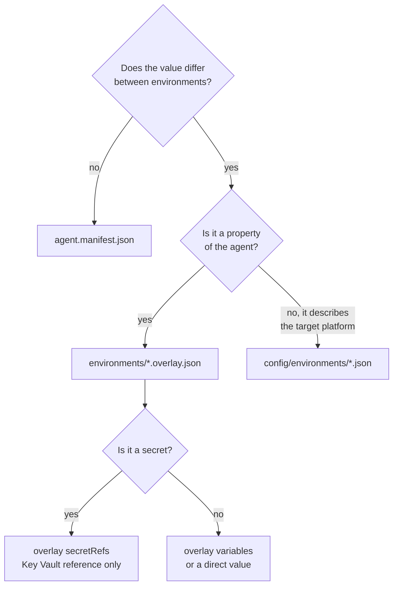
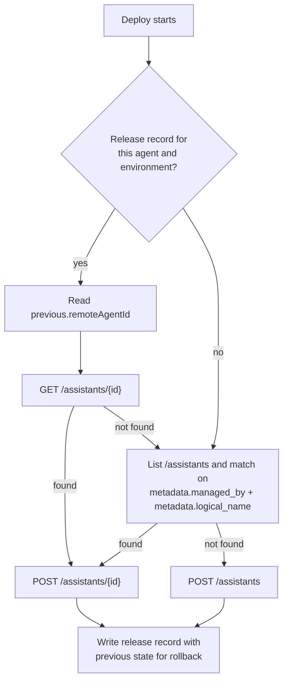

# Deployment patterns

How a source folder becomes a running agent, and the patterns to choose between when you adopt this in an
enterprise.

## The pipeline, in one page

| Stage | Command | Needs Azure | Fails when |
| --- | --- | --- | --- |
| Validate | `scripts/Invoke-Validation.ps1` | no | Schema, YAML, PowerShell, governance, IaC or credential heuristics fail |
| Package | `scripts/New-AgentPackage.ps1` | no | An overlay is missing, or an environment does not resolve to a valid payload |
| Verify | `scripts/Test-AgentPackage.ps1` | no | Checksums or the content address do not match |
| Deploy | `scripts/import-agent.ps1` | yes | Governance violation, unresolved placeholder, preflight failure, Agent Service error |
| Smoke | `tests/smoke/Invoke-SmokeTest.ps1` | yes | The agent is absent, reports the wrong version, or fails a canary |
| Evaluate | `tests/evaluations/Invoke-EvaluationSuite.ps1` | yes (or fixture mode) | Pass rate, failure count or p95 latency breaches the suite thresholds |
| Regress | `tests/regression/Invoke-RegressionTest.ps1` | yes | A previously asserted behaviour broke |
| Promote | `scripts/promote-agent.ps1` | yes | The artifact does not match the source release record, or the promotion order is violated |
| Roll back | `scripts/Invoke-Rollback.ps1` | yes | The previous package cannot be located |

## Pattern 1: repository layout

Two layouts work. Pick one per organisation and stay with it.

### Monorepo of agents (recommended to start)

```
agents/
  support-agent/
  kb-research-agent/
  operations-copilot/
config/environments/
scripts/
.github/workflows/
```

- One set of pipelines, one governance policy, one review process.
- Path filters on the deployment workflow scope a run to the agent that changed.
- Best when one platform team owns the agents.

### Agent per repository, shared accelerator

```
contoso/agent-platform            <- this accelerator, reusable workflows, shared templates
contoso/support-agent             <- one agent, calls the shared workflows
contoso/operations-copilot
```

- Each agent repository calls the platform's reusable workflows with
  `uses: contoso/agent-platform/.github/workflows/_reusable-deploy.yml@v1`.
- Best when separate product teams own separate agents and need independent release cadence.
- Requires the shared repository to be versioned with tags, and agent repositories to pin a tag.

## Pattern 2: environment separation

| Model | When to use | Trade-off |
| --- | --- | --- |
| Subscription per environment | Regulated workloads, strong blast radius control | Most Azure administration |
| Resource group per environment in one subscription | Default for most teams; what the IaC in this repository does | Shared subscription quota |
| Project per environment in one Foundry account | Cheapest, fastest to stand up | Shared account-level limits and a weaker security boundary; not recommended beyond a proof of concept |

The accelerator assumes one Foundry account and one project per environment. To use one account with several
projects, change only `foundry.accountName` and `foundry.projectEndpoint` in the environment configuration.

## Pattern 3: deployment strategies

### Direct replace (default)

`import-agent.ps1` updates the existing agent in place. Simple, immediate, and correct when the calling
application resolves the agent by its logical name through the release record.

### Side-by-side with a pinned id

Create a second agent for the new version and switch the calling application's configured agent id once you
are satisfied. Implement by giving the manifest a version-suffixed `name` for the candidate, then deploying
normally. The release record captures both ids, so the cutover is auditable.

Use this when the calling application pins an agent id and cannot tolerate an in-place behaviour change.

### Canary by traffic split

The Agent Service has no built-in traffic split. Implement it in the calling application: read two agent ids
from configuration and route a percentage to the candidate. The accelerator supports this by deploying two
logical agents; the split itself is an application concern, not a deployment concern. Do not pretend a
pipeline can do it.

## Pattern 4: what belongs in the manifest, the overlay, and the environment config



| Value | Where | Why |
| --- | --- | --- |
| Instruction text | manifest (`instructions.file`) | Behaviour must be identical everywhere |
| Agent logical name and version | manifest | Promotion key and audit identity |
| Owner, classification | manifest | Properties of the agent, not of a deployment |
| Model deployment name | overlay | Different capacity and models per environment |
| Temperature | overlay | Tightened as the package advances |
| Search index name, connection id | overlay `variables` | Environment-specific resources |
| Which tools are enabled | overlay `toolOverrides` | Capability is restricted in higher environments |
| API key or password | Key Vault, referenced from overlay `secretRefs` | Never in Git, never in the package |
| Project endpoint, api-version, Key Vault name | environment config | Describes the platform, not the agent |
| Allowed tool types, maximum sensitivity | environment config `governance` | Policy owned by the platform team |

## Pattern 5: tool payload mapping

`ConvertTo-FoundryAgentPayload` is the single place where a tool definition becomes Agent Service JSON.

| Tool definition | Produces |
| --- | --- |
| `type: azure_ai_search`, `config.connectionId`, `config.indexName`, `config.queryType`, `config.topK` | `tools[].type = azure_ai_search` and `tool_resources.azure_ai_search.indexes[] = { index_connection_id, index_name, query_type, top_k }` |
| `type: file_search`, `config.vectorStoreIds` | `tools[].type = file_search` and `tool_resources.file_search.vector_store_ids` |
| `type: code_interpreter` | `tools[].type = code_interpreter`, plus `tool_resources.code_interpreter.file_ids` when `config.fileIds` is set |
| `type: openapi`, `config.name`, `config.specFile`, `config.auth` | `tools[].openapi = { name, spec, auth }` with the specification inlined from the package |
| `type: function`, `config.name`, `config.parameters` | `tools[].function = { name, description, parameters }` |
| `type: azure_function`, `config.inputQueue`, `config.outputQueue` | `tools[].azure_function = { function, input_binding, output_binding }` with `storage_queue` bindings |
| `type: bing_grounding`, `config.connectionId` | `tools[].bing_grounding.search_configurations[]` |
| `type: mcp`, `config.serverLabel`, `config.serverUrl`, `config.allowedTools` | `tools[].{ type, server_label, server_url, allowed_tools }` |

Plus four metadata keys added to every agent, which is how the tooling recognises what it owns:

```json
"metadata": {
  "managed_by": "foundry-prompt-agent-cicd-accelerator",
  "logical_name": "operations-copilot",
  "agent_version": "2.1.0",
  "environment": "prod"
}
```

Agent Service metadata values must be strings and are limited to 16 pairs; the conversion enforces both.

## Pattern 6: idempotent create or update



Agent Service display names are not unique, so discovery never relies on them. The recorded id is the fast
path; metadata matching is the recovery path when the release store is unavailable or a record was lost.

## Pattern 7: gating

Gates are declared per environment in the overlay and enforced by the pipeline.

```json
"deploymentGates": {
  "requireEvaluationPass": true,
  "requireSmokeTestPass": true,
  "requireRegressionPass": true,
  "minimumEvaluationScore": 0.9
}
```

| Environment | Smoke | Regression | Evaluation | Secret references verified | Automatic rollback |
| --- | --- | --- | --- | --- | --- |
| DEV | yes | no | no | no | no, failures stay visible |
| TEST | yes | yes | yes, >= 0.85 | no | yes |
| UAT | yes | yes | yes, >= 0.90 | yes | yes |
| PROD | yes | yes | yes, >= 0.90 | yes | yes |

DEV deliberately does not roll back: a broken DEV deployment is information, and hiding it behind an automatic
revert makes debugging harder.

## Pattern 8: bringing an existing agent under control

```powershell
az login
./scripts/export-agent.ps1 -Environment dev -RemoteAgentId asst_0123456789 -OutputPath ./agents/legacy-agent
```

The export is read-only against Azure. It writes a manifest, instructions, tool definitions, one overlay and
`export-notes.md` listing everything that needs a human decision: environment-specific values replaced with
placeholders, tool types with no exact mapping, missing owner and classification.

Complete the notes, create the remaining overlays, run validation, then deploy through the pipeline so that
the recorded state and the running state converge.

## Pattern 9: operating several agents

- Use a workflow matrix over agent folders, or one workflow input per run. The reusable workflows already
  take `agentPath` and `agentName`.
- Give each agent its own evaluation suite and regression case file. Shared suites hide agent-specific
  regressions.
- Keep `config/environments/*.json` shared: the environment and its policy are platform-owned, and one policy
  per agent defeats the purpose of governance.
- Release records are keyed by `<agent>/<environment>`, so agents never overwrite each other's history.

## Anti-patterns

| Anti-pattern | Why it fails | Instead |
| --- | --- | --- |
| Rebuilding the package for each environment | Production runs bytes nobody tested | Promote the artifact |
| Editing the agent in the portal to fix production | The repository and reality diverge silently | Fix in Git, redeploy; use `export-agent.ps1` if drift already happened |
| One overlay per customer or tenant | Overlay count explodes and review becomes impossible | Keep four environments; make tenant differences runtime parameters of the calling application |
| Secrets in overlay `variables` | They end up in the package and in Git | `secretRefs` with a Key Vault reference |
| Skipping UAT because the change is small | Small changes to instructions cause the largest behaviour shifts | Use the promotion path; use `-AllowSkipEnvironment -Justification` only for a recorded exception |
| `continue-on-error` on a gate | A gate that cannot fail is not a gate | Fix the test or remove it deliberately |
