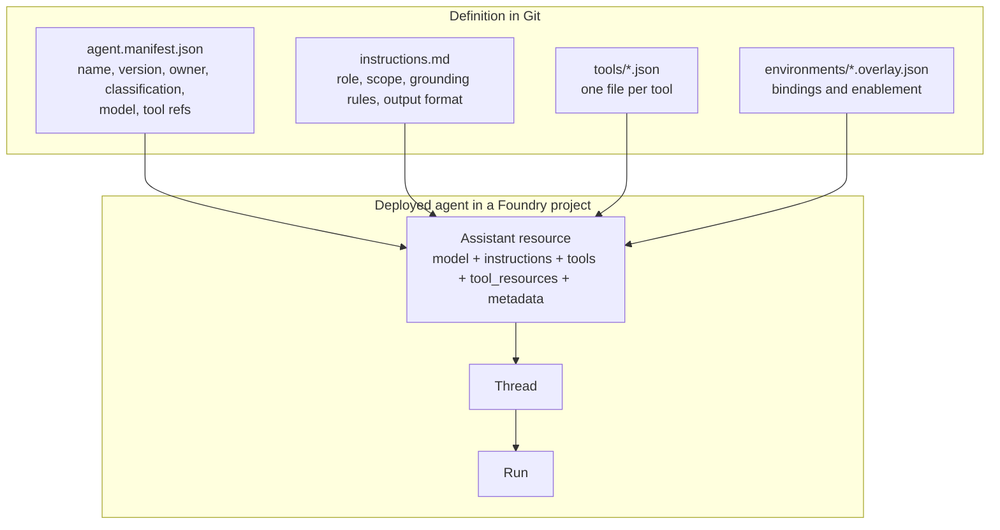
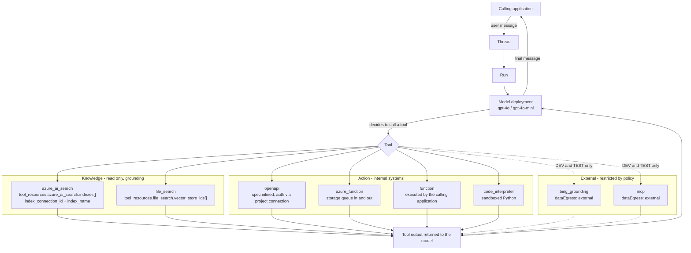
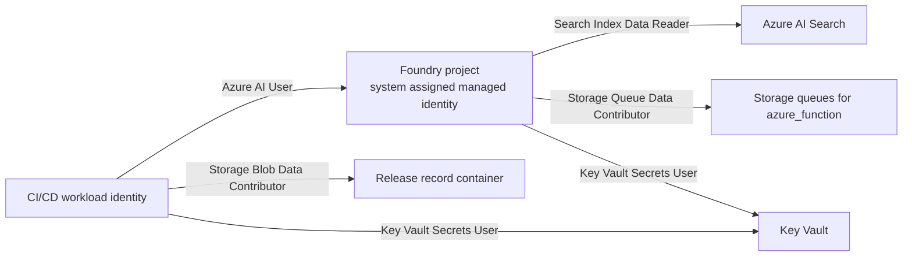
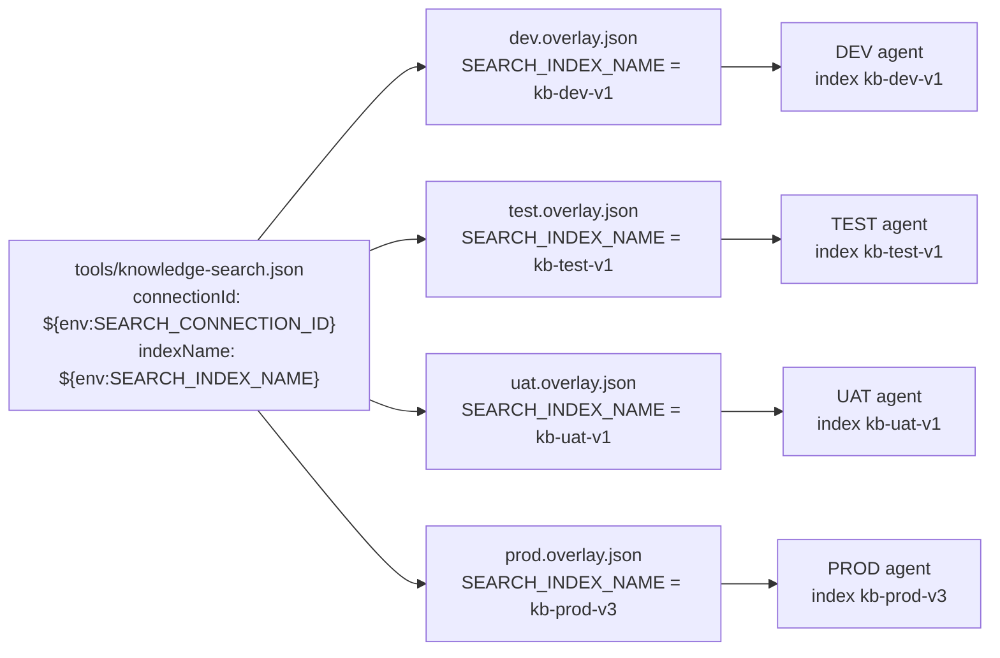

# Diagram: agent, knowledge and tools

How a prompt agent, its knowledge sources and its action tools fit together, and where each piece is defined
in this repository.

## Composition



## Knowledge and tools at run time



## Identity and data access

The Foundry **project** has a system-assigned managed identity. That identity, not the deployment identity,
is what reads your knowledge sources at run time.



Confusing these two identities is the most common cause of a deployment that succeeds and an agent that
cannot retrieve anything. The deployment identity creates the agent; the project identity serves it.

## Environment binding of a knowledge tool



Placeholders resolve iteratively, so an overlay variable may itself contain a placeholder. This is how the
samples build a full connection id from `${env:AZURE_SUBSCRIPTION_ID}`, which the pipeline supplies:

```json
"SEARCH_CONNECTION_ID": "/subscriptions/${env:AZURE_SUBSCRIPTION_ID}/resourceGroups/rg-foundry-agents-prod/providers/Microsoft.CognitiveServices/accounts/aifagentsprod/projects/proj-agents-prod/connections/kb-search"
```

An unresolved placeholder aborts the deployment with the list of missing names. It never becomes an empty
string.

## Tool type reference

| `type` | Payload shape produced | Environment-specific values | Default policy |
| --- | --- | --- | --- |
| `azure_ai_search` | `tools[].type` plus `tool_resources.azure_ai_search.indexes[]` | connection id, index name | allowed everywhere |
| `file_search` | `tools[].type` plus `tool_resources.file_search.vector_store_ids[]` | vector store ids | allowed everywhere |
| `openapi` | `tools[].openapi` with the spec inlined | connection id or audience | allowed everywhere |
| `azure_function` | `tools[].azure_function` with queue bindings | queue service endpoint | allowed everywhere |
| `function` | `tools[].function` | none; the caller executes it | allowed everywhere |
| `code_interpreter` | `tools[].type` | none | DEV and TEST only |
| `bing_grounding` | `tools[].bing_grounding.search_configurations[]` | connection id | DEV and TEST only, external egress |
| `mcp` | `tools[].server_label` and `server_url` | server URL | DEV and TEST only, external egress |

The mapping is implemented once, in `ConvertTo-FoundryAgentPayload`
(`scripts/modules/FoundryAgentOps/FoundryAgentOps.psm1`). An unknown type raises an error rather than being
skipped, so a typo cannot quietly remove a capability from a production agent.

## Disabling a tool for an environment

```json
"toolOverrides": {
  "code-interpreter": { "enabled": false },
  "web-grounding":    { "enabled": false }
}
```

A disabled tool is removed from the resolved definition before placeholder expansion. It therefore does not
appear in the payload, does not require its `${env:...}` bindings in that environment, and is not evaluated by
the governance gate. `samples/multi-tool-agent` resolves to five tools in DEV and TEST and three in UAT and
PROD from one package.

Tell the agent about it in the instructions. `samples/multi-tool-agent/instructions.md` states which
capabilities are absent in UAT and PROD and how to respond, so behaviour degrades in a defined way instead of
producing a confusing failure.
