# Diagram: Azure DevOps to Foundry

End-to-end flow using Azure Pipelines and workload identity federation.

## Full flow

```mermaid
flowchart TB
    subgraph DEVLOOP["Developer loop"]
        A1["Edit manifest, instructions, overlays"]
        A2["./scripts/Invoke-Validation.ps1"]
        A3["import-agent.ps1 -WhatIf"]
        A1 --> A2 --> A3 --> A4["Push branch"]
    end

    A4 --> PR["Pull request to main"]
    PR --> BV["Branch policy:<br/>validate.yml build validation"]

    subgraph VAL["validate.yml - no service connection"]
        V1["templates/steps/validate.yml"]
        V2["Schema, YAML, PowerShell, Bicep, Terraform"]
        V3["Package each sample twice<br/>and compare content addresses"]
    end
    BV --> V1 --> V2 --> V3
    V3 --> REVIEW["Required reviewers<br/>code owners"]
    REVIEW --> MERGE["Merge to main"]

    subgraph DEVP["deploy-dev.yml"]
        D1["Stage: validate"]
        D2["Stage: build<br/>templates/steps/package.yml<br/>BUILD ONCE"]
        D3[("Pipeline artifact: agentPackage")]
        D4["Stage: deployDev<br/>templates/stages/deploy-stage.yml"]
    end
    MERGE --> D1 --> D2 --> D3
    D2 --> D4

    subgraph WIF["Authentication"]
        W1["AzureCLI@2 with service connection<br/>foundry-agents-dev"]
        W2["Workload identity federation<br/>no stored secret"]
        W3["Authenticated az session in the task"]
    end
    D4 --> W1 --> W2 --> W3
    W3 --> DEP1["Verify descriptor-bound package<br/>resolve overlay + governance + preflight<br/>stage prior package + attested JSON<br/>persist started BEFORE create + verify pin"]
    DEP1 --> FDEV["Foundry DEV project"]
    DEP1 --> SM1["Release-bound live gates<br/>SDK Conversations/Responses<br/>Complete-Release attestation"]
    SM1 --> R1["Attested release record artifact<br/>transported with the package"]

    D3 --> TESTP["deploy-test.yml (manual)<br/>resources.pipelines: devPipeline"]
    subgraph PROMO["Promotion, no rebuild"]
        T1["download: devPipeline<br/>package + attested DEV release"]
        T2["Test-AgentPackage.ps1<br/>content address must match"]
        T3["Environment foundry-agents-test<br/>approval check"]
        T4["promote-agent.ps1 with the TEST overlay"]
        T5["Smoke + regression + evaluations"]
        T6["Environment foundry-agents-uat<br/>approval + business hours"]
    end
    TESTP --> T1 --> T2 --> T3 --> T4 --> T5 --> T6

    T6 --> PRODP["deploy-prod.yml (manual)<br/>resources.pipelines: testPipeline"]
    subgraph PRODGATE["Production"]
        P1["Stage preflight:<br/>typed confirmation, change record format,<br/>artifact verification"]
        P2["Environment foundry-agents-prod<br/>approval + business hours + exclusive lock + branch control"]
        P3["Promote identical package"]
        P4["Required live gates + Complete-Release<br/>exact release/service identity"]
        P5{"Passed?"}
        P6["Release record"]
        P7["One verified Invoke-Rollback attempt<br/>prior package + attested JSON<br/>new service version + required gates"]
    end
    PRODP --> P1 --> P2 --> P3 --> P4 --> P5
    P5 -->|yes| P6
    P5 -->|no| P7
```

The same Python 3.10+ plus `scripts/python/requirements.txt` prerequisite applies to Azure DevOps agents.
The shipped stage selects Python 3.11, installs those exact pins, and invokes `scripts/Complete-Release.ps1`
after smoke/regression/evaluation with an always-running condition. Each runner receives the exact returned
`-ReleaseRecordPath`; evidence binds release/package/project/manifest/service identity and post-activation
times. Required smoke includes a live canary. Offline, skipped, unbound, failed or missing required evidence
marks the record failed before the separate staged-artifact rollback handler runs.

That handler and the manual workflow use centralized `Invoke-Rollback.ps1`: exact failed/current context,
retained prior package and attested release JSON, drift checks, a new service version, required target-overlay
gates and `Complete-Release`. No pending record counts as recovery, and a recovered forward job still fails.
First deployment without a known-good prior artifact requires explicit manual recovery and may be exposed
before gates. Source/SDK validation has not qualified these paths against Azure.

Deploy, test and rollback use the same Environment with `lockBehavior: sequential`. Configure its exclusive-lock
check externally for every managed environment; YAML alone does not create that check. Concurrent out-of-band
routing edits are unsupported, and before/after checks cannot prove the absence of transient external edits.

## Why `resources.pipelines` rather than a repository checkout of the package

Declaring the upstream pipeline as a resource and using `download: devPipeline` binds the promotion to a
specific completed run. The pipeline still checks out `self`, but only to get the scripts and the environment
configuration; the agent bytes come from the artifact. `Test-AgentPackage.ps1` then recomputes the content
descriptor-bound `/2` address (or strict legacy `/1`), so substitution fails before mutation. Reproducible IDs
do not guarantee byte-identical ZIP builds; promotion carries the original archive unchanged. Target overlays
and external model/knowledge/connection/secret state can still yield different runtime behaviour.

## Azure DevOps configuration required

| Item | Value |
| --- | --- |
| Service connections | `foundry-agents-dev`, `-test`, `-uat`, `-prod`, all Azure Resource Manager with workload identity federation |
| Variable groups | `foundry-agents-<env>` with non-secret `azureSubscriptionId` and `azureTenantId` |
| Environments | `foundry-agents-dev` (no checks), `-test` (approval), `-uat` (approval, business hours), `-prod` (approval, business hours, exclusive lock, branch control on `refs/heads/main`) |
| Branch policy on `main` | Build validation against `validate.yml`, minimum reviewers, required reviewers by path, no force push |
| Pipeline resource names | Update `source:` in `deploy-test.yml` and `deploy-prod.yml` to your pipeline names |
| Retention | Increase artifact retention beyond your longest promotion window; rollback replays these artifacts |

## Approval placement

All approvals are Environment checks. None are expressed in YAML. A contributor cannot weaken a production
gate through a pull request to this repository, because the gate is not in the repository.

## Secrets

Variable groups hold identifiers only. Agent secrets live in Key Vault and are referenced by the overlay
`secretRefs` block; `import-agent.ps1 -ValidateSecretReferences` proves the deployment identity can read them
before it writes anything, and the values never leave a `SecureString`.
