# Diagram: GitHub to Foundry

End-to-end flow from a pull request to a deployed agent, using GitHub Actions and OpenID Connect.

## Full flow

```mermaid
flowchart TB
    subgraph DEVLOOP["Developer loop"]
        A1["Edit agent.manifest.json,<br/>instructions.md, overlays"]
        A2["./scripts/Invoke-Validation.ps1<br/>offline, no Azure"]
        A3["import-agent.ps1 -WhatIf<br/>see the exact payload"]
        A1 --> A2 --> A3 --> A4["Push branch"]
    end

    A4 --> PR["Pull request to main"]

    subgraph CI["validate.yml - no credentials"]
        V1["JSON and schema validation"]
        V2["YAML validation"]
        V3["PowerShell parser + Pester"]
        V4["Bicep build, Terraform fmt and validate"]
        V5["Resolve every sample in every environment"]
        V6["Governance evaluation"]
        V7["Credential heuristics"]
        V8["Reproducible build check<br/>same source, same packageId"]
    end

    PR --> V1 --> V2 --> V3 --> V4 --> V5 --> V6 --> V7 --> V8
    V8 --> REVIEW["Code owner review<br/>.github/CODEOWNERS"]
    REVIEW --> MERGE["Merge to main"]

    subgraph DEVWF["deploy-dev.yml"]
        D1["_reusable-validate.yml"]
        D2["_reusable-package.yml<br/>BUILD ONCE"]
        D3[("Artifact: agent-package<br/>retention 90 days")]
        D4["_reusable-deploy.yml<br/>environment: dev"]
    end

    MERGE --> D1 --> D2 --> D3
    D2 --> D4

    subgraph OIDC["Authentication"]
        O1["Request OIDC token<br/>subject repo:owner/repo:environment:dev"]
        O2["Entra ID validates the federated credential"]
        O3["Access token, Azure AI User"]
    end

    D4 --> O1 --> O2 --> O3
    O3 --> DEPLOY1["Verify package<br/>Resolve overlay<br/>Governance gate<br/>Preflight<br/>POST /assistants"]
    DEPLOY1 --> FDEV["Foundry DEV project"]
    DEPLOY1 --> SMOKE1["Smoke test"]
    SMOKE1 --> REC1["Release record<br/>blob + artifact"]

    D3 --> TESTWF["deploy-test.yml (manual)<br/>input: sourceRunId"]
    subgraph PROMO["Promotion, no rebuild"]
        T1["Download artifact from the DEV run"]
        T2["Verify content address"]
        T3["GitHub Environment 'test'<br/>required reviewers"]
        T4["promote-agent.ps1<br/>TEST overlay applied"]
        T5["Smoke + regression + evaluations"]
        T6["GitHub Environment 'uat'<br/>second approval"]
    end
    TESTWF --> T1 --> T2 --> T3 --> T4 --> T5 --> T6

    T6 --> PRODWF["deploy-prod.yml (manual)<br/>change record + typed confirmation"]
    subgraph PRODGATE["Production"]
        P1["Preflight: verify artifact,<br/>agent name, change record format"]
        P2["GitHub Environment 'prod'<br/>reviewers + wait timer + branch policy"]
        P3["Promote identical package"]
        P4["Smoke + regression"]
        P5{"Passed?"}
        P6["Release record"]
        P7["Automatic rollback<br/>to previous packageId"]
    end
    PRODWF --> P1 --> P2 --> P3 --> P4 --> P5
    P5 -->|yes| P6
    P5 -->|no| P7
```

## Why the artifact is passed by run id

`deploy-test.yml` takes a `sourceRunId` and downloads that run's artifact with
`actions/download-artifact@v4` using `run-id`. This is what makes promotion verifiable: the job cannot
accidentally rebuild from a newer `main`, because it never reads agent source at all. The first thing it does
is recompute the content address and compare it with the descriptor.

## GitHub configuration required

| Item | Value |
| --- | --- |
| Environments | `dev`, `test`, `uat`, `prod` |
| Environment variables (per environment) | `AZURE_CLIENT_ID`, `AZURE_TENANT_ID`, `AZURE_SUBSCRIPTION_ID` - identifiers, stored as variables not secrets |
| Protection on `test` | Required reviewers, deployment branch policy limited to `main` |
| Protection on `uat` | Required reviewers including the business owner |
| Protection on `prod` | Required reviewers, wait timer, branch and tag policy for `main` and `v*.*.*` |
| Federated credentials | One per environment: `repo:OWNER/REPO:environment:dev` and so on |
| Ruleset on `main` | Require pull request, require the `validate` check, require code owner review, block force push |
| Workflow permissions | Read repository contents by default; `id-token: write` only where OIDC is needed |

## What is not in GitHub

No client secret, certificate or `AZURE_CREDENTIALS` blob. The only Azure-related values stored in GitHub are
three GUIDs that identify an app registration, a tenant and a subscription. On their own they grant nothing.
