# Diagram: GitHub to Foundry

End-to-end flow from a pull request to a deployed agent, using GitHub Actions and OpenID Connect.

## Full flow

```mermaid
flowchart TB
    subgraph DEVLOOP["Developer loop"]
        A1["Edit agent.manifest.json,<br/>instructions.md, overlays"]
        A2["./scripts/Invoke-Validation.ps1<br/>offline, no Azure"]
        A3["import-agent.ps1 -WhatIf<br/>structural summary + digest"]
        A1 --> A2 --> A3 --> A4["Push branch"]
    end

    A4 --> PR["Pull request to main"]

    subgraph CI["validate.yml - no credentials"]
        V1["JSON and schema validation"]
        V2["YAML validation"]
        V3["PowerShell parser + Pester"]
        V4["Bicep build, Terraform fmt and validate"]
        V5["Resolve every sample in every environment"]
        V6["Governance evaluation"]
        V7["Credential heuristics"]
        V8["Reproducible build check<br/>same source, same packageId"]
    end

    PR --> V1 --> V2 --> V3 --> V4 --> V5 --> V6 --> V7 --> V8
    V8 --> REVIEW["Code owner review<br/>.github/CODEOWNERS"]
    REVIEW --> MERGE["Merge to main"]

    subgraph DEVWF["deploy-dev.yml"]
        D1["_reusable-validate.yml"]
        D2["_reusable-package.yml<br/>BUILD ONCE"]
        D3[("Artifact: agent-package<br/>retention 90 days")]
        D4["_reusable-deploy.yml<br/>environment: dev"]
    end

    MERGE --> D1 --> D2 --> D3
    D2 --> D4

    subgraph OIDC["Authentication"]
        O1["Request OIDC token<br/>subject repo:owner/repo:environment:dev"]
        O2["Entra ID validates the federated credential"]
        O3["Access token, Azure AI User"]
    end

    D4 --> O1 --> O2 --> O3
    O3 --> DEPLOY1["Verify descriptor-bound package<br/>resolve overlay + governance + preflight<br/>stage prior package + attested JSON<br/>persist started BEFORE create + verify pin"]
    DEPLOY1 --> FDEV["Foundry DEV project"]
    DEPLOY1 --> GATES1["Release-bound live gates<br/>SDK Conversations/Responses"]
    GATES1 --> ATTEST1["Complete-Release.ps1<br/>attests release"]
    ATTEST1 --> REC1["Release record<br/>succeeded or failed"]

    D3 --> TESTWF["deploy-test.yml (manual)<br/>input: sourceRunId"]
    subgraph PROMO["Promotion, no rebuild"]
        T1["Download artifact from the DEV run"]
        T2["Verify content address"]
        T3["GitHub Environment 'test'<br/>required reviewers"]
        T4["promote-agent.ps1<br/>TEST overlay applied"]
        T5["Smoke + regression + evaluations"]
        T6["GitHub Environment 'uat'<br/>second approval"]
    end
    TESTWF --> T1 --> T2 --> T3 --> T4 --> T5 --> T6

    T6 --> PRODWF["deploy-prod.yml (manual)<br/>change record + typed confirmation"]
    subgraph PRODGATE["Production"]
        P1["Preflight: verify artifact,<br/>agent name, change record format"]
        P2["GitHub Environment 'prod'<br/>reviewers + wait timer + branch policy"]
        P3["Promote identical package"]
        P4["Required live gates + Complete-Release<br/>exact release/service identity"]
        P5{"Passed?"}
        P6["Release record"]
        P7["One Invoke-Rollback attempt<br/>prior package + attested JSON<br/>new service version + required gates"]
    end
    PRODWF --> P1 --> P2 --> P3 --> P4 --> P5
    P5 -->|yes| P6
    P5 -->|no| P7
```

Inside `_reusable-deploy.yml`, GitHub Actions installs Python 3.11 and `scripts/python/requirements.txt`
before invoking `import-agent.ps1` or `promote-agent.ps1`. The same workflow now runs
`scripts/Complete-Release.ps1` after the smoke/evaluation/regression steps, so the release is only final once
the record has moved beyond `pending-verification`. Each runner receives the exact deployment result's
`-ReleaseRecordPath`; evidence binds the attempt, package, manifest semver, opaque service version, environment,
endpoint and post-activation times. Required smoke needs a live canary, not configuration-only checks.
Missing, empty, skipped, offline, unbound or failed required evidence marks
the record failed and fails the job.

Each promotion handoff carries both the immutable package and the source environment's attested release record.
`promote-agent.ps1` schema-validates that transported record, avoiding cross-environment release-store access.

Failure invokes a separate `Invoke-Rollback.ps1` step using the exact failed/current release context and prior
package **plus attested release JSON** staged by import whenever durable
evidence says runtime mutation started and the prior artifact exists. This also covers an import/promote command
that exits nonzero after potentially mutating creation; a pre-mutation failure does not roll back.
Recovery creates a new service version and runs the target package's required live gates and attestation.
Pending verification is not recovery success, and the original deployment job still fails after recovery.
`Complete-Release.ps1` is not also called with `-RollbackOnFailure` in this workflow.

Deployment/testing and the manual rollback workflow share the `foundry-<environment>-<agentName>` concurrency
identity. Out-of-band concurrent routing edits are unsupported; before/after route checks are not proof
that no transient external edit occurred. First deployment without a known-good prior artifact requires
manual recovery and may be exposed before gates. These paths remain Azure-unverified.

## Why the artifact is passed by run id

`deploy-test.yml` takes a `sourceRunId` and downloads that run's artifact with
`actions/download-artifact@v4` using `run-id`. This is what makes promotion verifiable: the job cannot
accidentally rebuild from a newer `main`, because it never reads agent source at all. The first thing it does
is verify the descriptor-bound `/2` content address (or strict legacy `/1`) and compare it with the release.
Reproducible IDs do not guarantee identical ZIP bytes; promotions transport the original archive unchanged.
Per-environment resolution and external state still change runtime behaviour.

## GitHub configuration required

| Item | Value |
| --- | --- |
| Environments | `dev`, `test`, `uat`, `prod` |
| Environment variables (per environment) | `AZURE_CLIENT_ID`, `AZURE_TENANT_ID`, `AZURE_SUBSCRIPTION_ID` - identifiers, stored as variables not secrets |
| Protection on `test` | Required reviewers, deployment branch policy limited to `main` |
| Protection on `uat` | Required reviewers including the business owner |
| Protection on `prod` | Required reviewers, wait timer, branch and tag policy for `main` and `v*.*.*` |
| Federated credentials | One per environment: `repo:OWNER/REPO:environment:dev` and so on |
| Ruleset on `main` | Require pull request, require the `validate` check, require code owner review, block force push |
| Workflow permissions | Read repository contents by default; `id-token: write` only where OIDC is needed |

## What is not in GitHub

No client secret, certificate or `AZURE_CREDENTIALS` blob. The only Azure-related values stored in GitHub are
three GUIDs that identify an app registration, a tenant and a subscription. On their own they grant nothing.
