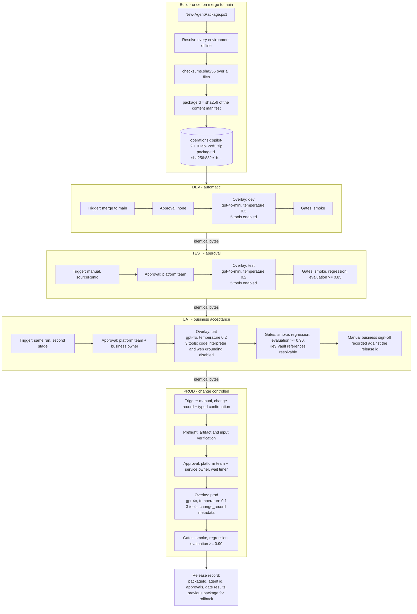
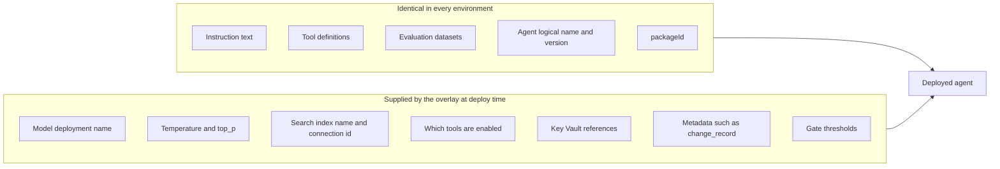
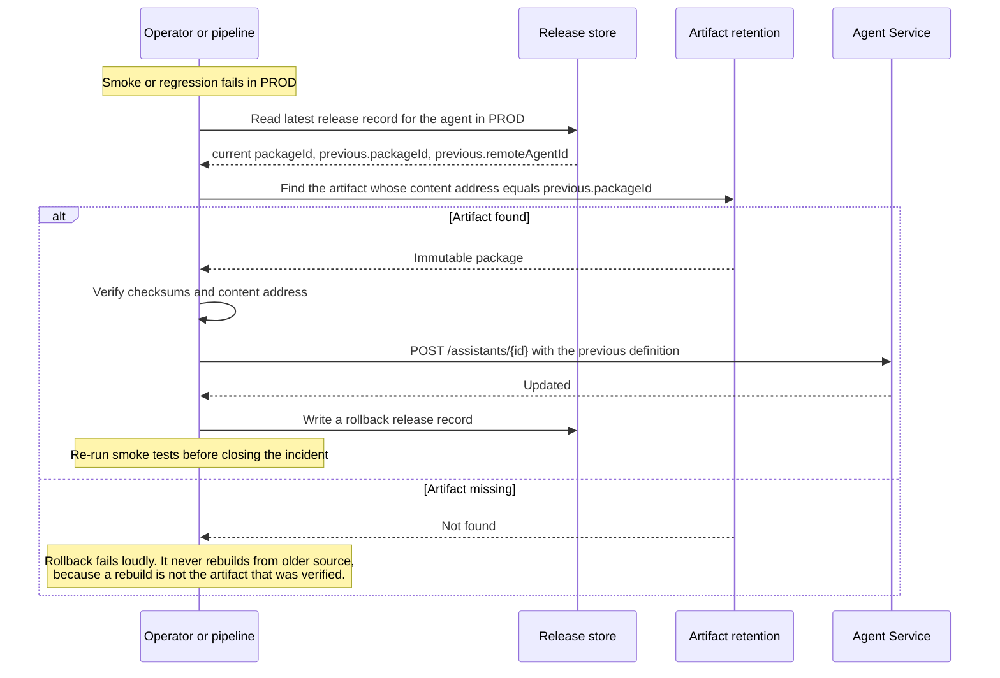

# Diagram: multi-environment promotion

One artifact, four environments, increasing control at each step.

## Promotion of one package

## What changes between environments and what does not

If a value needs to differ between environments it belongs in the overlay. If it does not, it belongs in the
manifest. There is no third place, which is what keeps promotion honest.

## Rollback

Rollback keeps the target environment's approval gate. A rollback is still a production change.

## Promotion rules enforced in code

`scripts/promote-agent.ps1` refuses to:

| Situation | Behaviour |
| --- | --- |
| Promote backwards, for example PROD to TEST | Error. Use rollback instead. |
| Promote from an environment with no successful release record | Error naming the missing record. |
| Promote an artifact whose content address differs from the source release record | Error. Rebuilding is not permitted. |
| Skip an environment, for example DEV to PROD | Error unless `-AllowSkipEnvironment` and `-Justification` are both supplied, which is then logged. |
| Deploy to an environment the package has no overlay for | Error naming the environments the package carries. |

## UAT

UAT is a first-class environment in the configuration, the schemas, the overlays, the governance policy and
the promotion order, even though only DEV, TEST and PROD have dedicated pipeline filenames.

| Aspect | UAT |
| --- | --- |
| GitHub | Environment `uat`, deployed by the second stage of `deploy-test.yml` |
| Azure DevOps | Environment `foundry-agents-uat`, stage `promoteUat` in `deploy-test.yml`, enabled by the `promoteToUat` parameter |
| Policy | Responsible AI review id required; `bing_grounding` and `mcp` removed from the allowed tool types; maximum temperature 0.7 |
| Purpose | Business acceptance against production-like data with production-shaped restrictions, before the change window |

Give UAT its own pipeline file if your change process needs a separately schedulable UAT cycle: copy
`deploy-test.yml` to `deploy-uat.yml` and keep only the UAT stage. The stage template does not change.
