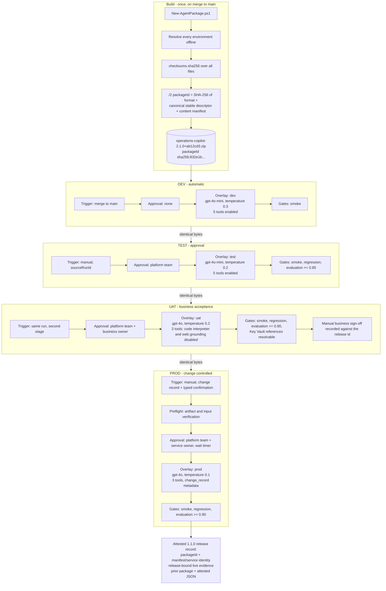
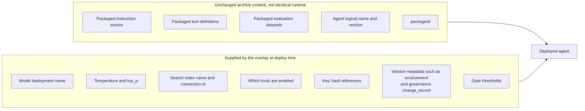

# Diagram: multi-environment promotion

One artifact, four environments, increasing control at each step.

## Promotion of one package



Each deployment writes `pending-verification` first. The environment only becomes promotable after
`scripts/Complete-Release.ps1` has attached release-bound live evidence and marked the record `succeeded`.
Runners receive the exact `-ReleaseRecordPath`; package, release, environment, endpoint, manifest semver,
opaque service version and execution after verified activation must agree. Required smoke needs at least one
successful live canary; fixtures, baseline updates, unbound, skipped, empty or failed required results cannot pass.

`/2` identity excludes only the specified volatile descriptor provenance; strict descriptor-bound `/1`
verification remains. Reproducible IDs are not byte-identical ZIP builds. Promotion carries the retained
original archive without rebuilding, and same-ID/different-byte blob publication fails.

## What changes between environments and what does not



Package-owned differences belong in overlays; stable source belongs in the manifest. Resolved instructions
and tools can differ. External model deployments, knowledge contents, connections, secrets and environment
configuration are not frozen by the archive, so each environment needs its own live gates. `agent.version`
is manifest semver; every deployment creates a separate opaque service version and release attempt.

## Rollback

```mermaid
sequenceDiagram
    participant OPS as Operator or pipeline
    participant REC as Release store
    participant ART as Artifact retention
    participant AS as Agent Service

    Note over OPS: Smoke or regression fails in PROD
    OPS->>REC: Load exact failed/current release context
    REC-->>OPS: previous package + release + service identity
    OPS->>ART: Find prior package AND exact attested release JSON
    alt Both retained and verified
        ART-->>OPS: Immutable package + known-good release
        OPS->>AS: Verify serving version is recorded candidate or prior
        OPS->>OPS: Verify target-overlay gates/prerequisites
        OPS->>AS: Create new service version; pin 100% and read back
        AS-->>OPS: Verified new routing, not recovery yet
        OPS->>AS: Required live gates via SDK Conversations/Responses
        OPS->>REC: Complete-Release attests rollback succeeded or failed
        Note over OPS: Only succeeded is verified recovery.<br/>Original forward job remains failed.
    else Artifact or known-good record missing
        ART-->>OPS: Not found
        Note over OPS: Rollback fails loudly. It never rebuilds from older source,<br/>because a rebuild is not the artifact that was verified.
    end
```

Rollback keeps the target environment's approval gate. A rollback is still a production change. In the
reusable deploy workflows, import stages the exact prior package before mutation and returns its path to the
single failure handler, along with the prior attested JSON. `latest.json` is only the latest audit attempt,
not evidence of active or known-good state. `Invoke-Rollback.ps1` centralizes redeployment, required live
gates and attestation, with no recursive recovery; manual workflows do not duplicate those gates.

Deploy, test and rollback must share an agent/environment lock. Managed live routing is an enabled Responses
endpoint with one fixed concrete version at 100%, verified before/after invocation, not latest or split traffic.
Out-of-band concurrent routing edits are unsupported and transient changes may escape observation.
First creation can affect traffic before explicit pinning/gates; without a known-good prior artifact, failure
requires explicit manual recovery. Rollback replays package source, not frozen external runtime state.
Authenticated Azure deployment, inference and recovery remain unqualified by offline validation.

## Promotion rules enforced in code

`scripts/promote-agent.ps1` refuses to:

| Situation | Behaviour |
| --- | --- |
| Promote backwards, for example PROD to TEST | Error. Use rollback instead. |
| Promote from an environment with no successful release record | Error naming the missing record. |
| Promote an artifact whose content address differs from the source release record | Error. Rebuilding is not permitted. |
| Skip an environment, for example DEV to PROD | Error unless `-AllowSkipEnvironment` and `-Justification` are both supplied, which is then logged. |
| Deploy to an environment the package has no overlay for | Error naming the environments the package carries. |

## UAT

UAT is a first-class environment in the configuration, the schemas, the overlays, the governance policy and
the promotion order, even though only DEV, TEST and PROD have dedicated pipeline filenames.

| Aspect | UAT |
| --- | --- |
| GitHub | Environment `uat`, deployed by the second stage of `deploy-test.yml` |
| Azure DevOps | Environment `foundry-agents-uat`, stage `promoteUat` in `deploy-test.yml`, enabled by the `promoteToUat` parameter |
| Policy | Responsible AI review id required; `bing_grounding` and `mcp` removed from the allowed tool types; maximum temperature 0.7 |
| Purpose | Business acceptance against production-like data with production-shaped restrictions, before the change window |

Give UAT its own pipeline file if your change process needs a separately schedulable UAT cycle: copy
`deploy-test.yml` to `deploy-uat.yml` and keep only the UAT stage. The stage template does not change.
