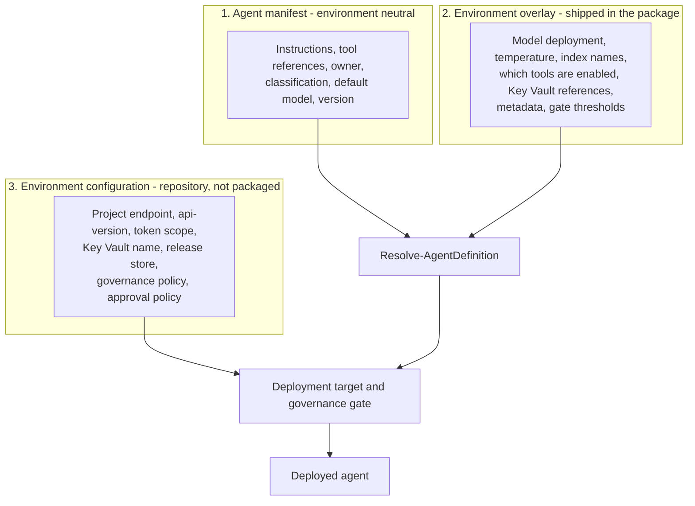

# Environment management

## The four environments

| Environment | Purpose | Deploys when | Approval | Data |
| --- | --- | --- | --- | --- |
| **DEV** | Fast feedback for the agent team | Automatically on merge to `main` | none | synthetic only |
| **TEST** | Integration and automated quality gates | Manual promotion from DEV | platform team | synthetic plus masked samples |
| **UAT** | Business acceptance under production-like restrictions | Manual promotion from TEST | platform team plus business owner | production-like, governed |
| **PROD** | Live | Manual promotion from UAT with a change record | platform team plus service owner | production |

Promotion is strictly forward: `dev -> test -> uat -> prod`. `promote-agent.ps1` enforces the order and
refuses to skip an environment unless `-AllowSkipEnvironment` and `-Justification` are both supplied.

## Three layers of configuration



Layer 2 travels inside the package, which is why promotion needs no rebuild. Layer 3 stays in the repository,
because it describes the platform rather than the agent, and because the platform team owns it under
`CODEOWNERS`.

## Overlay reference

```json
{
  "$schema": "../../../schemas/environment-overlay.schema.json",
  "schemaVersion": "1.0.0",
  "environment": "prod",
  "model": {
    "deploymentName": "gpt-4o",
    "parameters": { "temperature": 0.1 }
  },
  "toolOverrides": {
    "knowledge-search": { "config": { "indexName": "kb-prod-v3", "topK": 5 } },
    "code-interpreter": { "enabled": false }
  },
  "variables": {
    "SEARCH_CONNECTION_ID": "/subscriptions/${env:AZURE_SUBSCRIPTION_ID}/resourceGroups/rg-foundry-agents-prod/providers/Microsoft.CognitiveServices/accounts/aifagentsprod/projects/proj-agents-prod/connections/kb-search",
    "CHANGE_RECORD_ID": "CHG-0000000"
  },
  "secretRefs": {
    "ORDERS_API_KEY": "@Microsoft.KeyVault(VaultName=kv-fnd-agents-prod;SecretName=orders-api-key)"
  },
  "metadata": { "environment": "prod", "change_record": "${env:CHANGE_RECORD_ID}" },
  "deploymentGates": {
    "requireEvaluationPass": true,
    "requireSmokeTestPass": true,
    "requireRegressionPass": true,
    "minimumEvaluationScore": 0.9
  }
}
```

### Merge semantics

| Construct | Behaviour |
| --- | --- |
| Objects | Deep merged. `model.parameters.temperature` can be overridden without restating `topP`. |
| Arrays and scalars | Replaced wholesale. An overlay can shrink a list. |
| `toolOverrides` | Keyed by tool `id`, deep merged into `config`. An override for an unknown id is an error, so a renamed tool cannot leave a dead override behind. |
| `metadata` | Merged over the manifest metadata. |
| Disabled tools | Removed from the resolved definition entirely. They produce no payload entry and require none of their placeholders in that environment. |

### Every environment needs an overlay

Even when it only restates defaults. `Resolve-AgentDefinition` fails with
`No overlay found for environment '<env>'` rather than falling back. Silent defaults are how a production
agent ends up on a development model.

## Placeholders

Any string in an overlay, tool definition or environment configuration may contain `${env:NAME}`.

Resolution order:

1. The overlay `variables` map.
2. The process environment.
3. Unresolved: the deployment fails with the full list of missing names.

Expansion is iterative (bounded to five passes), so a variable's value may itself contain a placeholder. This
is how the samples compose a full connection id from `${env:AZURE_SUBSCRIPTION_ID}`, which the pipeline
supplies and which is therefore never committed.

```powershell
# See what a package would resolve to, without deploying and without credentials
$env:AZURE_SUBSCRIPTION_ID = '<subscription guid>'
./scripts/import-agent.ps1 -PackagePath ./out/operations-copilot-2.1.0+ab12cd3.zip -Environment prod -WhatIf
```

## Secrets

Never place a secret value in the manifest, an overlay, a tool definition, an environment configuration, a
pipeline variable or a command line argument.

```json
"secretRefs": {
  "ORDERS_API_KEY": "@Microsoft.KeyVault(VaultName=kv-fnd-agents-prod;SecretName=orders-api-key)"
}
```

- The reference format is validated by the schema, so a malformed reference fails in the pull request.
- `import-agent.ps1 -ValidateSecretReferences` reads each one before any write, proving the deployment
  identity has `Key Vault Secrets User`. Values are held as `SecureString` and never printed.
- Prefer a Foundry project connection over an agent-held secret where the tool supports one: the connection
  keeps the credential entirely inside the platform.

### Rotation

1. Add the new secret version to Key Vault.
2. If the reference pins `SecretVersion`, update the overlay, bump the agent version and promote. If it does
   not pin a version, the next run of the agent picks up the current version with no deployment.
3. Disable the old version only after smoke tests pass in every environment that uses it.

Pin `SecretVersion` when you need a rotation to be a reviewable, promotable change. Leave it unpinned when you
need rotation to be operationally independent of the release cycle. Choose deliberately and be consistent.

## Environment configuration reference

`config/environments/<env>.json`, validated by `schemas/environment-config.schema.json`.

| Section | Field | Notes |
| --- | --- | --- |
| `azure` | `tenantId`, `subscriptionId` | Use `${env:...}`. The pipeline supplies them. |
| `azure` | `resourceGroup`, `location` | Replace with your values. |
| `foundry` | `accountName`, `projectName` | From the IaC outputs. |
| `foundry` | `projectEndpoint` | `https://<account>.services.ai.azure.com/api/projects/<project>` |
| `foundry` | `apiVersion` | Pinned explicitly. Verify against your project before the first deployment. |
| `foundry` | `tokenScope` | Normally `https://ai.azure.com/.default`. |
| `keyVault` | `name`, `uri` | Environment vault. |
| `releaseStore` | `type`, `accountName`, `container` | `azureBlob` or `local`. |
| `deployment` | `autoDeploy`, `approvalRequired`, `approverGroups`, `changeWindow`, `rollbackMode` | Documents intent; the platform enforces approvals. |
| `governance` | `allowedToolTypes`, `maxDataSensitivity`, `requireOwnerMetadata`, `requireResponsibleAiReview`, `requiredMetadataKeys`, `maxTemperature` | Hard gate evaluated at deploy time. |

### Policy differences in the shipped configuration

| Setting | DEV | TEST | UAT | PROD |
| --- | --- | --- | --- | --- |
| `autoDeploy` | true | false | false | false |
| `approvalRequired` | false | true | true | true |
| Allowed tool types | all 8 | all 8 | 6 (no `bing_grounding`, no `mcp`) | 5 (also no `code_interpreter`) |
| `maxDataSensitivity` | confidential | confidential | confidential | confidential |
| `requireResponsibleAiReview` | false | false | true | true |
| `requiredMetadataKeys` | none | `service` | `service` | `service`, `change_record` |
| `maxTemperature` | 1.5 | 1.0 | 0.7 | 0.5 |
| Log retention (IaC) | 30 days | 60 days | 90 days | 365 days |

`maxDataSensitivity` is `confidential` everywhere on purpose. `highly-confidential` workloads need an isolated
landing zone with private endpoints and a separate approval chain, which is a deliberate decision rather than
a configuration flag. Differentiation between environments comes from tool policy, temperature caps, review
requirements and approvals.

## Adding a fifth environment

For example a pre-production performance environment:

1. Add the name to the `environment` enum in `schemas/environment-config.schema.json`,
   `schemas/environment-overlay.schema.json`, `schemas/evaluation-suite.schema.json` and
   `schemas/release-record.schema.json`.
2. Add it to the `ValidateSet` on `$Environment` in every script and to `$script:ValidEnvironments` in the
   module.
3. Add it to `$promotionOrder` in `scripts/promote-agent.ps1` in the correct position.
4. Create `config/environments/<name>.json`.
5. Create `environments/<name>.overlay.json` for every agent, and rebuild packages.
6. Create the GitHub or Azure DevOps environment with its approvals.
7. Add a stage to the promotion pipeline using the existing reusable workflow or stage template.

Step 5 is the one people forget: existing packages carry only the environments they were built with, and
`import-agent.ps1` refuses to deploy to an environment the package has no overlay for.

## Drift

Drift means the running agent no longer matches the last release record: someone edited it in the portal.

Detect it:

```powershell
./scripts/export-agent.ps1 -Environment prod -AgentName operations-copilot -OutputPath ./out/drift-check
git diff --no-index ./agents/operations-copilot/instructions.md ./out/drift-check/instructions.md
```

Correct it by redeploying the recorded package:

```powershell
./scripts/import-agent.ps1 -PackagePath ./artifacts/operations-copilot-2.1.0+ab12cd3.zip -Environment prod
```

Prevent it by removing write access to production projects for humans. Operators should hold `Azure AI User`
for read and test, not a role that can update an agent. The deployment identity should be the only principal
that writes.

Schedule the drift check weekly against PROD and UAT. An unexplained difference is an incident, not a
housekeeping task.
