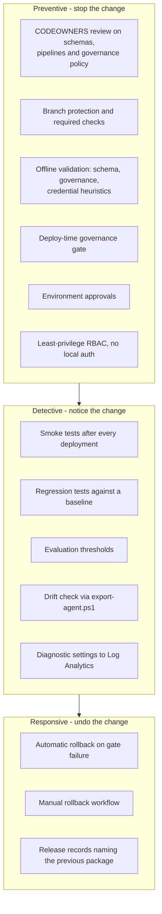

# Governance

Governance here means four things you must be able to evidence: **who approved a change**, **what exactly is
running**, **what the agent is allowed to do**, and **how you would undo it**.

## Control map



## What is enforced in code

These are not guidance. They fail a build or a deployment.

| Control | Enforced by | Failure mode |
| --- | --- | --- |
| Manifest, overlay, tool and suite conform to schema | `Invoke-Validation.ps1`, `Resolve-AgentDefinition` | Pull request fails |
| Every packaged environment has an explicit overlay | `New-AgentPackage.ps1` | Package build fails |
| Tool type is permitted in the target environment | `Test-AgentGovernance` | Deployment fails before any write |
| Tool `allowedEnvironments` respected | `Test-AgentGovernance` | Deployment fails |
| Data sensitivity within the environment ceiling | `Test-AgentGovernance` | Deployment fails |
| `owner.team` present | `Test-AgentGovernance` | Deployment fails |
| Responsible AI review id present in UAT and PROD | `Test-AgentGovernance` | Deployment fails |
| Required metadata keys present | `Test-AgentGovernance` | Deployment fails |
| Temperature within the environment cap | `Test-AgentGovernance` | Deployment fails |
| Package integrity and content address | `Test-AgentPackage.ps1`, `Expand-AgentPackage` | Deployment fails |
| Promotion uses the artifact recorded for the source environment | `promote-agent.ps1` | Promotion fails |
| Promotion order and no skipping | `promote-agent.ps1` | Promotion fails without an explicit justification |
| Change record format in production | `deploy-prod.yml` preflight | Run fails before approval is requested |
| Unknown tool type | `ConvertTo-FoundryAgentPayload` | Validation and deployment fail |
| No plausible credential in source | `Invoke-Validation.ps1` heuristics | Pull request fails |

## Policy definition

Per environment, in `config/environments/<env>.json`:

```json
"governance": {
  "allowedToolTypes": ["file_search", "azure_ai_search", "openapi", "azure_function", "function"],
  "maxDataSensitivity": "confidential",
  "requireOwnerMetadata": true,
  "requireResponsibleAiReview": true,
  "requiredMetadataKeys": ["service", "change_record"],
  "maxTemperature": 0.5
}
```

Changing this file is a control change. `CODEOWNERS` routes `/config/environments/` to the platform and
security reviewers, and `prod.json` additionally to the service owners. Treat a pull request that widens
`allowedToolTypes` in production with the same seriousness as a firewall rule change.

## Defence in depth: the external egress example

`bing_grounding` and `mcp` send prompt content outside the tenant boundary. The accelerator blocks them from
UAT and production three independent ways:

1. **Tool declaration.** `governance.allowedEnvironments: ["dev", "test"]` in the tool definition.
2. **Overlay.** `toolOverrides: { "web-grounding": { "enabled": false } }` in the UAT and PROD overlays.
3. **Environment policy.** The type is absent from `allowedToolTypes` in `uat.json` and `prod.json`.

Any single layer can be removed by mistake and the control still holds. Copy this pattern for any capability
whose misuse would be a reportable event.

## Approvals

Approvals live on the platform, not in YAML, so a pull request to this repository cannot weaken them.

| Environment | GitHub Environment protection | Azure DevOps Environment checks |
| --- | --- | --- |
| DEV | none | none |
| TEST | required reviewers: platform team; branch policy `main` | approval: platform team |
| UAT | required reviewers: platform team and business owner | approval plus business hours |
| PROD | required reviewers: platform team and service owner; wait timer; branch and tag policy | approval, business hours, exclusive lock, branch control on `refs/heads/main` |

Production additionally requires, before approval is even requested:

- a change record id matching `^[A-Za-z]{2,5}-[0-9]{4,10}$`;
- the agent name typed again as a confirmation;
- a verified artifact whose content address matches the one recorded for UAT.

The preflight publishes the package id to the run summary so that approvers can compare it against the UAT
release record instead of trusting the request.

## Audit evidence

For any deployment, the release record answers every audit question:

| Question | Field |
| --- | --- |
| What was deployed? | `packageId`, `agent.name`, `agent.version` |
| Where? | `environment`, `agent.remoteAgentId` |
| When? | `deployment.deployedAtUtc` |
| Who? | `deployment.deployedBy`, `deployment.pipelineRunUrl` |
| Was it a promotion? | `deployment.operation`, `deployment.sourceEnvironment` |
| Which gates passed? | `deployment.gateResults` |
| What did it replace? | `previous.packageId`, `previous.agentVersion`, `previous.releaseId` |
| Who approved it? | The run's approval history plus `deployment.approvals` |

Records are written to blob storage as `<agent>/<environment>/<releaseId>.json` with a `latest.json` pointer,
and retained as pipeline artifacts for a year. Enable blob versioning and a lifecycle policy that meets your
retention obligation; the IaC enables versioning already.

## Responsible AI

The manifest carries the declaration:

```json
"classification": {
  "dataSensitivity": "confidential",
  "businessCriticality": "high",
  "processesPersonalData": true,
  "humanInTheLoop": true,
  "responsibleAiReviewId": "RAI-2026-0304"
}
```

UAT and PROD require `responsibleAiReviewId`. The accelerator does not validate the id against a review
system; wire that into the gate if you have an API for it. What it does guarantee is that an agent cannot
reach UAT or production without someone having recorded a review reference, and that the reference is in the
package and the audit record.

Content safety filters are a property of the model deployment, not the agent. The IaC sets
`raiPolicyName: 'Microsoft.DefaultV2'` on every deployment and `versionUpgradeOption: NoAutoUpgrade` so the
model version cannot change under a promoted package. Replace the policy name with your organisation's custom
policy.

### Agent-specific risks

| Risk | Control in this repository | Your responsibility |
| --- | --- | --- |
| Indirect prompt injection through retrieved documents | Sample instructions state that tool output is data, not instruction; regression cases assert the refusal | Add cases specific to your content sources |
| Hallucinated facts presented as grounded | Instructions require citation and explicit no-hit wording; evaluation cases include negative lookups | Extend the dataset with your real failure modes |
| Data exfiltration through an external tool | Three-layer egress control described above | Review every new tool's `dataEgress` value |
| Configuration or instruction disclosure | Smoke and regression probes on every deployment | Keep the probes current as instructions change |
| Over-broad agent permissions | The project managed identity gets reader-level data roles only | Do not grant it write roles on systems of record |
| Silent capability change | Tool count is asserted by the smoke test against the resolved package | Pass `-ExpectedToolCount` in your pipeline |
| Untracked agents created in the portal | `managed_by` metadata plus the drift procedure | Remove human write access to production |

## Cost governance

| Lever | Where |
| --- | --- |
| Model choice per environment | Overlay `model.deploymentName`: `gpt-4o-mini` in DEV and TEST, `gpt-4o` in UAT and PROD |
| Capacity per environment | `modelDeployments[].capacity` in the IaC parameters |
| Evaluation dataset size | `dataset.maxRecords` in the suite; evaluations consume tokens on every promotion |
| Smoke test breadth | `tests/smoke/smoke-checks.json`; keep it to a handful of prompts |
| Search SKU | `basic` in DEV and TEST, `standard` in UAT and PROD in the shipped parameters |
| Log retention | 30 days in DEV rising to 365 in PROD |

Tag every resource with `costCenter` and `owner`; both IaC implementations apply the tag map to every
resource, and the manifest carries `owner.costCenter` so an agent can be attributed even when several share a
project.

## Adoption checklist

Before the first production deployment:

- [ ] `CODEOWNERS` lists real teams and branch protection requires code owner review.
- [ ] Federated credential subjects are scoped to the specific repository and environment.
- [ ] The deployment identity holds only Azure AI User, Key Vault Secrets User and Storage Blob Data
      Contributor.
- [ ] Humans do not hold write access to the production project.
- [ ] `governance.allowedToolTypes` for production has been reviewed by security.
- [ ] Every agent has an owner, a contact, a classification and a Responsible AI review id.
- [ ] Production environment protection includes reviewers, a wait timer and a branch policy.
- [ ] Release store retention meets your audit obligation, and artifact retention exceeds your rollback
      horizon.
- [ ] A rollback has been rehearsed end to end in TEST.
- [ ] The drift check is scheduled against UAT and PROD.
- [ ] Secret scanning with push protection is enabled on the repository.
