# Package format

Specification of `foundry-agent-package/2`, the immutable artifact produced by
`scripts/New-AgentPackage.ps1` and consumed by every deployment, promotion and rollback.
Strict descriptor-bound `/1` verification remains supported; new builds use `/2`.

## Goals

1. **Build once.** Promote the same archive UAT verified, resolving the target overlay separately.
2. **Self-verifying.** Verify checksums and descriptor-bound identity; these are not publisher signatures.
3. **Promotable without rebuild.** Every environment overlay travels inside the package.
4. **Immutable.** Nothing is written into the package after it is built, including deployment records.
5. **Recoverable.** Redeploy a retained known-good package as a new service version, then verify its gates.

## Layout

```
operations-copilot-2.1.0+ab12cd3.zip
  package.json                          descriptor: content address, identity, provenance, inventory
  checksums.sha256                      SHA-256 of every other file, including package.json
  manifest/
    agent.manifest.json
    instructions.md
    README.md                           copied from the agent source folder, if present
    tools/
      knowledge-search.json
      orders-api.json
      orders-api.openapi.json
      entitlement-check.json
      code-interpreter.json
      web-grounding.json
    evaluations/
      operations.evaluation.json
      dataset.jsonl
  environments/
    dev.overlay.json
    test.overlay.json
    uat.overlay.json
    prod.overlay.json
```

Everything from the agent source folder except `environments/` is copied under `manifest/`, so paths that the
manifest declares relative to itself (`tools/orders-api.json`) keep resolving. Overlays move to the package
root so that `manifest/` holds only environment-neutral content.

## File name

```
<agentName>-<agentVersion>+<shortCommit>.zip
```

`agentVersion` comes from the manifest. `shortCommit` is the first seven characters of the source commit, or
`local` for a local build. The file name is convenience only: identity is the content address.

## Content address

```
contentManifest = checksums of content files, excluding package.json and checksums.sha256
projectedDescriptor = complete descriptor minus packageId and the volatile build fields listed below
packageId = "sha256:" + SHA256(
    "foundry-agent-package/2\n" + canonicalProjectedDescriptor + "\n" + contentManifest)
```

The single builder/verifier implementation is
`Get-PackageId -ChecksumManifest <text> -Descriptor <complete descriptor>`. It hashes UTF-8 without a BOM.
Canonical descriptor object keys and inventory paths use ordinal ordering; unordered inventory/environment
lists are normalized deterministically. Finalize the descriptor, including `fileCount`, before hashing.
The content checksum manifest uses LF, one final newline, and ordinal package-relative path ordering:

```
9f2b1c...e41  environments/dev.overlay.json
3ac77d...b02  manifest/agent.manifest.json
...
```

For `/2`, the projection excludes only top-level `packageId` and `build.createdUtc`, `build.buildRunId`,
`build.buildRunUrl`, `build.builder`, and `build.sourceRef`. All remaining descriptor values are bound,
including source commit/repository/tool version, owner/classification, inventory and `fileCount`.
`checksums.sha256` still covers every other file, including the final `package.json`. Volatile build fields
are therefore checksum-protected informational provenance, not package-ID-bound or independently authenticated.

Verification therefore has two independent parts, both performed by `Test-AgentPackage.ps1` and by
`Expand-AgentPackage` before any deployment:

1. Every file matches `checksums.sha256`, and no file is missing or unexpected.
2. The recomputed content address equals `package.json.packageId`.

Editing content or stable descriptor identity and regenerating checksums changes the package ID; promotion
compares it with the source release's recorded identity. Volatile provenance can change without changing the
`/2` ID. Verification also checks inventory and manifest/descriptor consistency. Checksums alone cannot
authenticate an artifact against a malicious producer who can replace both artifact and trusted records.

Legacy `/1` uses its original strict descriptor-bound algorithm, excluding only `packageId` from the
descriptor. There is no checksum-only or empty-descriptor fallback: malformed legacy packages and unknown
formats fail rather than acquiring a different identity.

## `package.json`

Validated by `schemas/package-descriptor.schema.json`.

```json
{
  "schemaVersion": "1.0.0",
  "packageFormat": "foundry-agent-package/2",
  "packageId": "sha256:832e1b6b034a6efe6371228a0c865d07203e950523f4fc63e96ba29723171286",
  "agent": {
    "name": "operations-copilot",
    "version": "2.1.0",
    "displayName": "Operations Copilot",
    "owner": { "team": "operations-engineering", "contact": "ops-engineering@contoso.example.com" },
    "classification": { "dataSensitivity": "confidential", "businessCriticality": "high" }
  },
  "build": {
    "createdUtc": "2026-09-15T21:44:59Z",
    "sourceCommit": "ab12cd34ef56...",
    "sourceRef": "refs/heads/main",
    "sourceRepository": "contoso/agent-platform",
    "buildRunId": "1842",
    "buildRunUrl": "https://github.com/contoso/agent-platform/actions/runs/1842",
    "builder": "github-actions",
    "toolVersion": "1.0.0"
  },
  "contents": {
    "manifest": "manifest/agent.manifest.json",
    "instructions": "manifest/instructions.md",
    "environments": ["dev", "test", "uat", "prod"],
    "tools": ["manifest/tools/knowledge-search.json"],
    "evaluations": ["manifest/evaluations/dataset.jsonl"]
  },
  "checksumFile": "checksums.sha256",
  "fileCount": 15
}
```

## Reproducibility

Identical source bytes and stable descriptor inputs produce the same `/2` `packageId`, even when build
time, run id/URL, builder or source ref differ. The build:

- writes JSON with LF endings and a single trailing newline;
- sorts checksum lines and canonical descriptor keys/inventory deterministically;
- excludes only the specified volatile descriptor fields from identity, not timestamps injected into content.

This is reproducible **content identity**, not a byte-identical ZIP guarantee: archive metadata and
informational descriptor fields may differ between builds. Promotion moves the original archive unchanged.
Publication treats an existing content-addressed blob as idempotent only if its archive bytes match the
incoming ZIP; the same ID with different ZIP bytes is a conflict, never an overwrite or silent substitution.

`validate.yml` and `azure-devops/pipelines/validate.yml` both build each sample twice and fail if the content
addresses differ. If you add a step that injects a timestamp or a random value into packaged content, that
check will catch it.

## Deployment

```mermaid
flowchart LR
    PKG[("package.zip")] --> EX["Expand-AgentPackage<br/>verify checksums + content address"]
    EX --> DESC["Read-PackageDescriptor"]
    DESC --> ENVCHK{"Overlay for the target<br/>environment present?"}
    ENVCHK -->|no| FAIL["Fail: rebuild with -Environment"]
    ENVCHK -->|yes| RES["Resolve-AgentDefinition<br/>manifest + overlay + tools"]
    RES --> EXP["Expand ${env:...} placeholders<br/>iteratively"]
    EXP --> GOV["Test-AgentGovernance"]
    GOV -->|violation| FAIL2["Fail with the list of violations"]
    GOV -->|compliant| PAY["ConvertTo-FoundryAgentPayload"]
    PAY --> PRE["SDK preflight + supported routing<br/>reconcile and stage prior package + release"]
    PRE --> REC["Publish candidate + prepared record<br/>persist mutation started BEFORE create"]
    REC --> WRITE["SDK create_version + persist identity<br/>pin selector + verify readback"]
    WRITE --> GATES["Release-bound live<br/>smoke/evaluation/regression"]
    GATES --> ATT["Complete-Release.ps1<br/>updates record with evidence"]
```



## Release records

A release record is the audit trail of one deployment. It is written **outside** the package, because writing
it inside would change the package hash.

`import-agent.ps1` writes the initial record with `deployment.outcome: pending-verification`.
`scripts/Complete-Release.ps1` is what attaches real gate evidence, updates `deployment.gateResults`, and
transitions the record to `succeeded` or `failed`. The example below illustrates selected attested fields.

New records use `schemaVersion: 1.1.0`. Version `1.0.0` remains readable for audit, but missing service
identity or unbound evidence cannot authorize new live attestation/promotion. Records are validated by
`schemas/release-record.schema.json`. Stored as:

- `<agent>/<environment>/<releaseId>.json` in the release store blob container
- `<agent>/<environment>/latest.json`, the latest audit attempt, not proof of serving or known-good state
- a pipeline artifact retained for one year

The following is an abbreviated field illustration, not a complete schema-valid record:

```json
{
  "schemaVersion": "1.1.0",
  "releaseId": "<unique deployment attempt>",
  "environment": "prod",
  "projectEndpoint": "https://<account>.services.ai.azure.com/api/projects/<project>",
  "packageId": "sha256:832e1b...",
  "agent": {
    "name": "operations-copilot",
    "version": "2.1.0",
    "remoteAgentId": "<logical agent resource id>",
    "serviceVersion": "<opaque SDK version>",
    "serviceVersionId": "<SDK version resource id>"
  },
  "governance": {
    "changeRecordId": "CHG-0043912",
    "responsibleAiReviewId": "RAI-2026-0304",
    "businessSignoffId": "BSO-0043912"
  },
  "deployment": {
    "deployedAtUtc": "2026-09-15T21:44:59Z",
    "deployedBy": "github:octocat",
    "outcome": "succeeded",
    "operation": "promote",
    "sourceEnvironment": "uat",
    "pipelineRunUrl": "https://github.com/contoso/agent-platform/actions/runs/1907",
    "runtimeMutation": {
      "started": true,
      "completed": true,
      "stage": "activated",
      "candidateVersion": "<opaque SDK version>",
      "startedAtUtc": "2026-09-15T21:44:59Z",
      "completedAtUtc": "2026-09-15T21:45:10Z"
    },
    "gateResults": { "smoke": "passed" },
    "attestation": {
      "gatesSatisfied": true,
      "attestedAtUtc": "2026-09-15T21:55:14Z",
      "attestedBy": "github:octocat",
      "evidence": {
        "smoke": {
          "executed": 4,
          "outcome": "passed",
          "score": null,
          "source": "./out/smoke-prod.json",
          "resultSha256": "<SHA-256 of retained result bytes>",
          "envelope": {
            "schemaVersion": "1.1.0",
            "gate": "smoke",
            "mode": "live",
            "releaseId": "<same deployment attempt>",
            "packageId": "sha256:832e1b...",
            "agentName": "operations-copilot",
            "environment": "prod",
            "projectEndpoint": "https://<account>.services.ai.azure.com/api/projects/<project>",
            "agentVersion": "2.1.0",
            "serviceVersion": "<same opaque SDK version>",
            "startedUtc": "2026-09-15T21:46:00Z",
            "executedUtc": "2026-09-15T21:47:00Z",
            "liveExecuted": 1
          }
        }
      }
    }
  },
  "previous": {
    "packageId": "sha256:5d91af...",
    "agentVersion": "2.0.3",
    "remoteAgentId": "<logical agent resource id>",
    "serviceVersion": "<prior opaque SDK version>",
    "serviceVersionId": "<prior SDK version resource id>",
    "releaseId": "<prior attested release>",
    "releaseRecordPath": "<staged prior release JSON>"
  }
}
```

`agent.version` is manifest semver; `agent.serviceVersion` is an opaque service identity, not a semantic
version. `remoteAgentId` is the logical resource id, not an assistant id. Release IDs distinguish retries,
including retries of the same package. `previous` binds a retained package **and attested release JSON** to
the prior serving service identity, not "the last build" or the newest audit file.

`schemas/release-record.schema.json` strictly declares the `deployment.attestation` gate requirements and
evidence written by `Complete-Release.ps1`, plus `previous.artifactRetained` and
`previous.rollbackArtifactPath`. Retained rollback state requires both a content-addressed package id and a
non-empty staged path. Successful new attestations require completed mutation, verified active selection,
and release-bound live evidence for every required gate; failed attestations permit empty evidence when a
test result was never produced. Production records require
the packaged Responsible AI review id, a change record matching `^[A-Za-z]{2,5}-[0-9]{4,10}$`, and a durable
business sign-off matching `^BSO-[0-9]{4,10}$`. Rollback records require the persisted reason. Unknown fields
remain rejected.

Each runner receives the exact deployment result's `-ReleaseRecordPath`. Evidence identities, project
endpoint, times (after verified activation, never future-dated), counters and completed Response IDs must
match independently loaded release/configuration expectations. Required smoke needs at least one successful
live canary; evaluation/regression require all cases to execute live. A minimum evaluation score also
requires valid live evaluation evidence. Offline fixtures, configuration-only smoke, baseline updates and
legacy/unbound results cannot authorize these gates. Invalid supplied evidence is not ignored even for an
optional gate. Result hashes bind retained bytes, not a cryptographic signature from Azure.

Rollback creates a new service version from the prior package and succeeds only after that package's target
overlay gates and `Complete-Release.ps1` pass. It does not restore frozen model, connection, knowledge or
secret state. First deployment without a prior artifact requires explicit manual recovery.

## Retention

Rollback and promotion both replay retained artifacts. Retention must exceed your longest promotion window
plus your rollback horizon.

| Store | Setting | Where |
| --- | --- | --- |
| GitHub build artifact | 90 days | `_reusable-package.yml` input `retentionDays` |
| GitHub promoted and production artifacts | 365 days | `actions/upload-artifact` in the promotion workflows |
| GitHub release records | 365 days | `_reusable-deploy.yml` |
| Azure DevOps artifacts | project retention policy | set it above your promotion window |
| Blob release store | lifecycle policy | keep at least 12 months for audit |

If an artifact has aged out, rollback fails with an explicit message rather than rebuilding. That is
deliberate: a rebuild is not the artifact that was verified.

## Versioning the format

`packageFormat` is `foundry-agent-package/2`; the descriptor document's `schemaVersion` remains `1.0.0`.
The `/2` increment records the changed content-address computation. Strict `/1` verification is retained
without rewriting IDs; unknown formats are rejected rather than read best-effort.

`schemaVersion` inside each JSON document versions that document's schema independently. Additive optional
fields do not require a bump; anything required, removed or renamed does.
