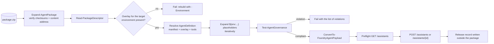

# Package format

Specification of `foundry-agent-package/1`, the immutable artifact produced by
`scripts/New-AgentPackage.ps1` and consumed by every deployment, promotion and rollback.

## Goals

1. **Build once.** Production runs the bytes that UAT verified.
2. **Self-verifying.** Any modification is detectable without an external index.
3. **Promotable without rebuild.** Every environment overlay travels inside the package.
4. **Immutable.** Nothing is written into the package after it is built, including deployment records.
5. **Reversible.** A previously promoted package can be redeployed exactly as it was.

## Layout

```
operations-copilot-2.1.0+ab12cd3.zip
  package.json                          descriptor: content address, identity, provenance, inventory
  checksums.sha256                      SHA-256 of every other file, including package.json
  manifest/
    agent.manifest.json
    instructions.md
    README.md                           copied from the agent source folder, if present
    tools/
      knowledge-search.json
      orders-api.json
      orders-api.openapi.json
      entitlement-check.json
      code-interpreter.json
      web-grounding.json
    evaluations/
      operations.evaluation.json
      dataset.jsonl
  environments/
    dev.overlay.json
    test.overlay.json
    uat.overlay.json
    prod.overlay.json
```

Everything from the agent source folder except `environments/` is copied under `manifest/`, so paths that the
manifest declares relative to itself (`tools/orders-api.json`) keep resolving. Overlays move to the package
root so that `manifest/` holds only environment-neutral content.

## File name

```
<agentName>-<agentVersion>+<shortCommit>.zip
```

`agentVersion` comes from the manifest. `shortCommit` is the first seven characters of the source commit, or
`local` for a local build. The file name is convenience only: identity is the content address.

## Content address

```
contentManifest = New-ChecksumManifest -Root <package> -ExcludeRelativePath @('package.json')
packageId       = "sha256:" + SHA256(contentManifest)
```

The checksum manifest is deterministic text, LF terminated, sorted by package-relative path:

```
9f2b1c...e41  environments/dev.overlay.json
3ac77d...b02  manifest/agent.manifest.json
...
```

`package.json` is excluded from the content address because it *contains* the content address. It is still
integrity protected: `checksums.sha256` is computed over every file including `package.json`, after the
descriptor is written.

Verification therefore has two independent parts, both performed by `Test-AgentPackage.ps1` and by
`Expand-AgentPackage` before any deployment:

1. Every file matches `checksums.sha256`, and no file is missing or unexpected.
2. The recomputed content address equals `package.json.packageId`.

Editing a packaged file fails check 1. Editing `package.json` to match fails check 2. Editing both
consistently produces a different `packageId`, which no longer matches the id recorded in the source
environment's release record, so promotion refuses it.

## `package.json`

Validated by `schemas/package-descriptor.schema.json`.

```json
{
  "schemaVersion": "1.0.0",
  "packageFormat": "foundry-agent-package/1",
  "packageId": "sha256:832e1b6b034a6efe6371228a0c865d07203e950523f4fc63e96ba29723171286",
  "agent": {
    "name": "operations-copilot",
    "version": "2.1.0",
    "displayName": "Operations Copilot",
    "owner": { "team": "operations-engineering", "contact": "ops-engineering@contoso.example.com" },
    "classification": { "dataSensitivity": "confidential", "businessCriticality": "high" }
  },
  "build": {
    "createdUtc": "2026-09-15T21:44:59Z",
    "sourceCommit": "ab12cd34ef56...",
    "sourceRef": "refs/heads/main",
    "sourceRepository": "contoso/agent-platform",
    "buildRunId": "1842",
    "buildRunUrl": "https://github.com/contoso/agent-platform/actions/runs/1842",
    "builder": "github-actions",
    "toolVersion": "1.0.0"
  },
  "contents": {
    "manifest": "manifest/agent.manifest.json",
    "instructions": "manifest/instructions.md",
    "environments": ["dev", "test", "uat", "prod"],
    "tools": ["manifest/tools/knowledge-search.json"],
    "evaluations": ["manifest/evaluations/dataset.jsonl"]
  },
  "checksumFile": "checksums.sha256",
  "fileCount": 15
}
```

## Reproducibility

Building the same source twice with the same `-SourceCommit` produces the same `packageId`. The build:

- writes JSON with LF endings and a single trailing newline;
- sorts checksum lines by path;
- excludes timestamps from everything the content address covers (`build.createdUtc` lives in
  `package.json`, which is excluded from the content address).

`validate.yml` and `azure-devops/pipelines/validate.yml` both build each sample twice and fail if the content
addresses differ. If you add a step that injects a timestamp or a random value into packaged content, that
check will catch it.

## Deployment



## Release records

A release record is the audit trail of one deployment. It is written **outside** the package, because writing
it inside would change the package hash.

Validated by `schemas/release-record.schema.json`. Stored as:

- `<agent>/<environment>/<releaseId>.json` in the release store blob container
- `<agent>/<environment>/latest.json`, overwritten each time
- a pipeline artifact retained for one year

```json
{
  "releaseId": "operations-copilot-prod-20260915T214459Z-832e1b6b034a",
  "environment": "prod",
  "packageId": "sha256:832e1b...",
  "agent": { "name": "operations-copilot", "version": "2.1.0", "remoteAgentId": "asst_..." },
  "deployment": {
    "deployedAtUtc": "2026-09-15T21:44:59Z",
    "deployedBy": "github:octocat",
    "outcome": "succeeded",
    "operation": "promote",
    "sourceEnvironment": "uat",
    "pipelineRunUrl": "https://github.com/contoso/agent-platform/actions/runs/1907",
    "gateResults": { "validation": "passed", "evaluation": "passed", "regression": "passed", "smoke": "passed" }
  },
  "previous": {
    "packageId": "sha256:5d91af...",
    "agentVersion": "2.0.3",
    "remoteAgentId": "asst_...",
    "releaseId": "operations-copilot-prod-20260901T101122Z-5d91af02c118"
  }
}
```

`previous` is what makes rollback deterministic: it names the exact package to redeploy, not "the last build"
or "the previous tag".

## Retention

Rollback and promotion both replay retained artifacts. Retention must exceed your longest promotion window
plus your rollback horizon.

| Store | Setting | Where |
| --- | --- | --- |
| GitHub build artifact | 90 days | `_reusable-package.yml` input `retentionDays` |
| GitHub promoted and production artifacts | 365 days | `actions/upload-artifact` in the promotion workflows |
| GitHub release records | 365 days | `_reusable-deploy.yml` |
| Azure DevOps artifacts | project retention policy | set it above your promotion window |
| Blob release store | lifecycle policy | keep at least 12 months for audit |

If an artifact has aged out, rollback fails with an explicit message rather than rebuilding. That is
deliberate: a rebuild is not the artifact that was verified.

## Versioning the format

`packageFormat` is `foundry-agent-package/1`. A breaking change to the layout or to the content address
computation increments it to `/2`, and `Read-PackageDescriptor` must then reject unknown formats rather than
attempt a best-effort read.

`schemaVersion` inside each JSON document versions that document's schema independently. Additive optional
fields do not require a bump; anything required, removed or renamed does.
